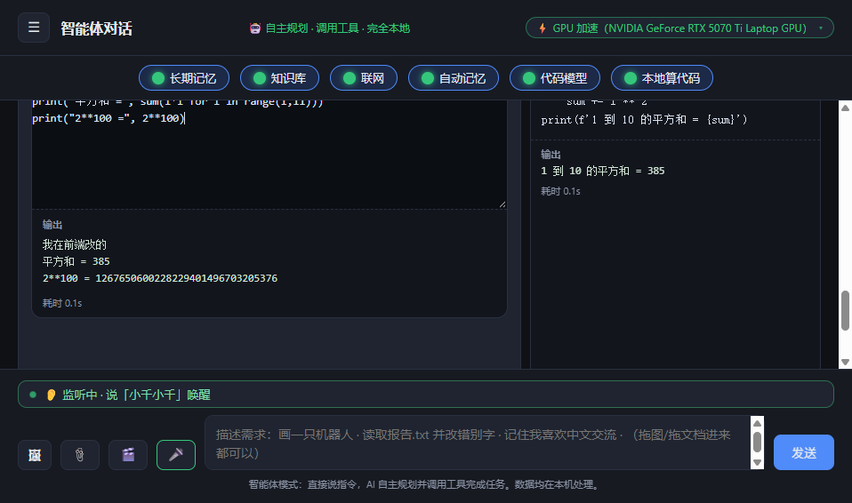
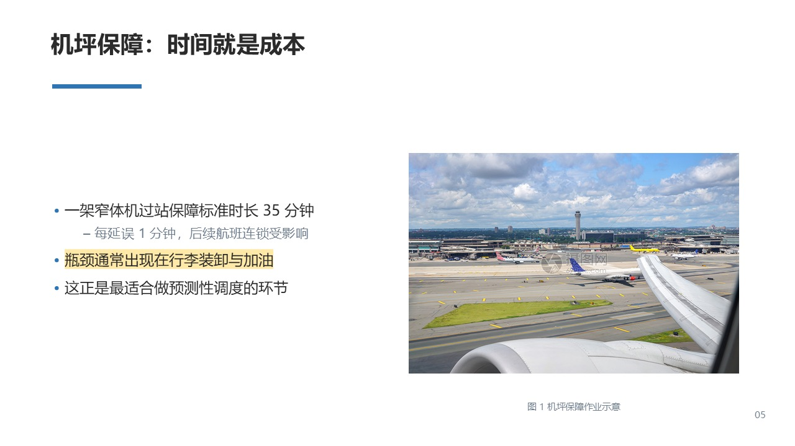
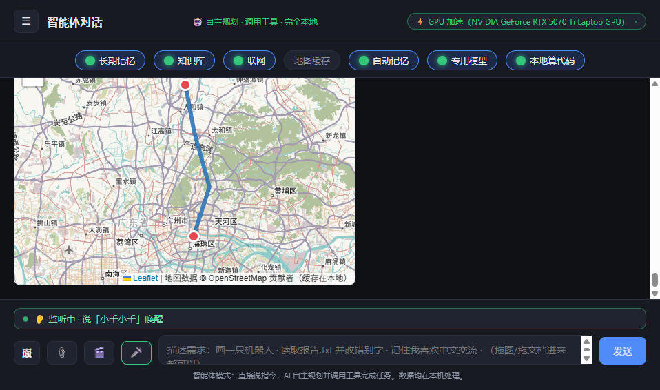
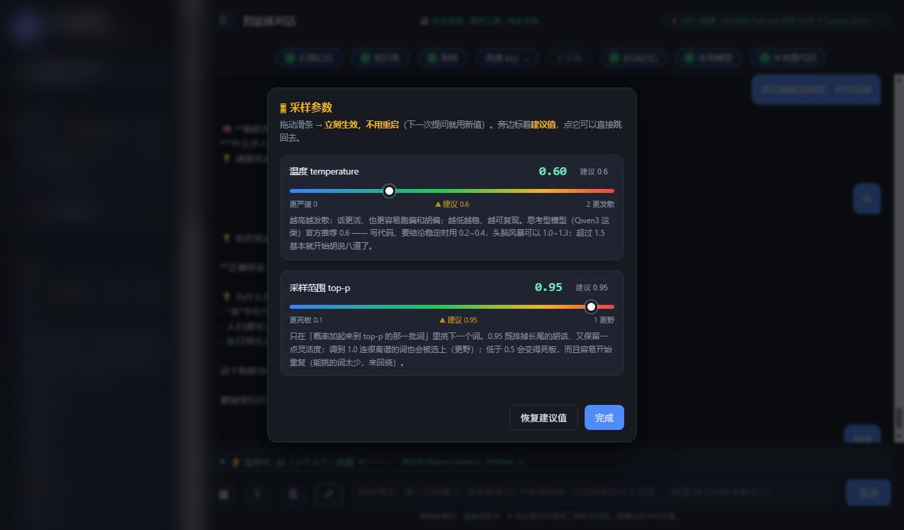
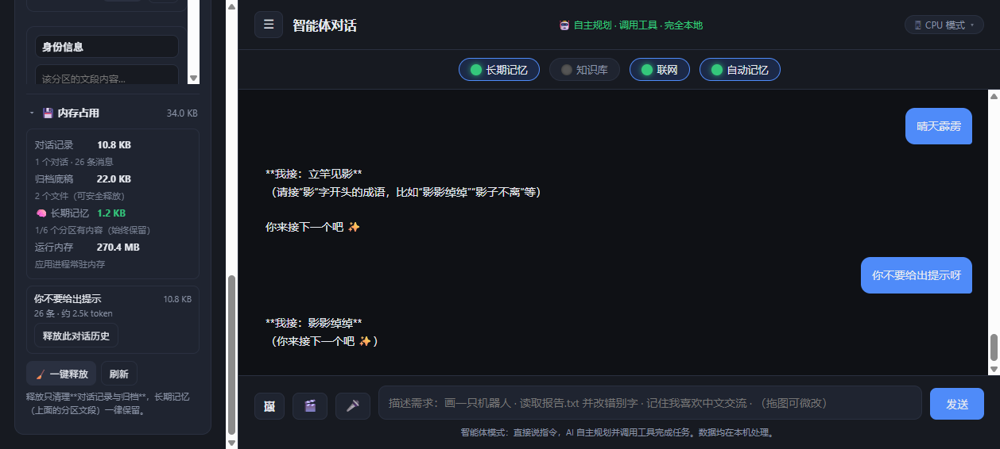

# Hardwordy Agent

**一个能自己读源码、改源码、给自己加模块的 AI 智能体 —— 也能整机离线跑**

70 个工具 · 105 个后端模块 · 415 个接口 · 14.8 万行代码 · **全栈自我迭代** · 数字人 · P2P 群聊 · 云端 / 本地双通道




> 工程实现与实验数据（四道质量闸、五层回滚链路，以及一项「自我改进不可证伪」的负面结果）见 **[PAPER.md](./PAPER.md)**。

---

## 下载

最新版是 **源码版 2026.11.23e**：源码树 + 便携 Python 3.14.4 + 随包模型（含 bge 向量模型 91 MB），
解压双击 `一键启动.bat`，**不装 Python、不配环境**。

| 版本 | 体积 | 从哪拿 |
|---|---|---|
| **源码版 2026.11.23e（最新）** | 4.10 GB | **网盘整包**（一个文件，不用合并；地址见 Release 说明或 Discussions 置顶） |
| [源码版 2026.11.21b](https://github.com/chenyt-Indom/hardwordy-agent/releases/tag/v2026.11.21b) | 4.10 GB（三卷） | GitHub Release 直接下 —— 单文件上限 2 GB，所以切三卷 |
| 源码 | — | 见下方「快速开始」；`git clone --depth 1` 即可，不必下 4 GB |

从 GitHub 下的三卷，放同一目录后合并（把版本号换成你下的那个）：

```cmd
copy /b HardwordyAgent-Source-2026.11.21b.zip.part1 + HardwordyAgent-Source-2026.11.21b.zip.part2 + HardwordyAgent-Source-2026.11.21b.zip.part3 HardwordyAgent-Source-2026.11.21b.zip
```

合并后的 SHA256 见该版本包内 `_说明.txt` 第八节 —— 三卷是从整包直接切出来的，与整包逐字节一致。

> **为什么是「源码版」而不是单 exe**：PyInstaller 版把后端编译进了 exe（PYZ），而自迭代改的是磁盘上的源码 ——
> 改完重启拉起来的还是 exe 里的旧字节码；再加上「只读资源在 `_internal\`、可写数据在 exe 同级」的双根问题，
> 表现为一堆目录找不到、模型读不到。源码版让 `app\` 直接就是项目根，与开发机结构一致。

> 包内**不含** AI 对话模型权重（由 Ollama 单独下载），也**不含**本地文生图
> （torch + SD 权重约 10 GB）。图片生成默认走云端 API，详见「已知限制」。

> 装不上、跑不起来、想问怎么用 → 先去 **[Discussions](https://github.com/chenyt-Indom/hardwordy-agent/discussions)**，比开 issue 回得快。

**装法（3 步）**

```powershell
# 1. 装 Ollama：https://ollama.com/download/windows

# 2. 下模型（18GB 主力 / 6GB 轻量）
ollama pull qwen3-vl:30b
# 或 ollama pull qwen3-vl:8b

# 3. 解压 zip → 双击 一键启动.bat（自动查 Ollama、等端口、开浏览器）
```

也可以完全不装 Ollama：启动后点右上角 **🔑 DeepSeek** 填一个 Key，直接用云端通道。

详细说明见包内 **`INSTALL.md`**。

---

## 这是什么

一个**能真正把事做完**的 AI 智能体 —— 不是只会回话的聊天框。

默认接 **DeepSeek V4.1**（云端），填个 Key 就能用；把模型切到本地 Ollama，它又能**整机离线运行，数据不出内网**。同一套 Agent 内核，两种部署形态。

它和"套壳聊天"的区别在四点：

| | 普通套壳 | Hardwordy Agent |
|---|---|---|
| **有手** | 只会输出文字 | **70 个工具**：读写文件、跑代码、搜网页、生成 PPT/Word/Excel、画图、剪视频、查地图、定时任务、数字人视频、跨网群聊 |
| **有记性** | 每次对话从零开始 | 分层记忆 + 向量索引 + 会话检索 + 知识库 + **任务经验库**（上次怎么做的、成没成） |
| **有工作台** | 只能聊天 | **开发工作区 + 开发台**：多项目、文件树、离线 Monaco 编辑器、内置真 VS Code、写代码专用模型、一键打包 / 推 GitHub |
| **能改自己** | 不可能 | **全栈自我迭代**：LLM 拿工具自己读代码、改、跑检查；能新建模块、注册新工具；改完自动复核，失败整条回滚 |

代码量 **14.8 万行**（后端 110,837 + 前端 34,637 + 救急脚本 2,046，不含文档与测试；**105 个后端模块、415 个接口**；统计时点 2026-11-23，随自迭代每日增长），
其中一大半的复杂度不在"调用模型"，而在**让模型安全地动真实文件和真实进程**。

如果你只有 30 秒：直接看 [全栈自我迭代](#全栈自我迭代llm-直接改代码) 和 [技术难点](#技术难点)。

---

## 为什么做这个

起点是想验证一件事：**一个"能自己动手"的 Agent，到底需要多少基础设施？**

市面上两类产品各缺一半：纯聊天的不动手；绑死某个平台的，你的数据、你的工具、你的工作流都得搬过去。
所以干脆自己搭一套，把三件事都握在手里：

1. **模型可选**：云端（DeepSeek V4.1，能力上限高）⇄ 本地（Ollama，数据不出机器），顶栏一键切；云端挂了自动降级到本地，对话不中断
2. **工具开放**：70 个工具都是本仓库的代码，想加就加，不用等平台排期
3. **能自我演进（全栈）**：前端和后端一起改，改坏了自动回滚 —— 这是"智能体"和"调用器"的分界线

**两种形态的成本对比**

|  | 云端模式（默认） | 本地模式（可选） |
|---|---|---|
| 前置投入 | 0（只填 Key） | 显卡（一次性） |
| 持续成本 | 按 token 计费（有 token 记账可查） | 仅电费 |
| 能力上限 | 顶级模型 | 本地 8B~30B |
| 数据流向 | 出机器（走 API） | **不出机器** |
| 可用性 | 依赖网络 | **断网可用** |
| 适合 | 日常干活、复杂任务、自我迭代 | 内网、涉密、合规、长期高频 |

**定位一句话**：不是"又一个聊天壳"，而是**一套能带走的 Agent 内核** —— 云端用得起，本地也搬得动。

---

## 界面速览

**对话与工具卡片** —— 70 个工具按需自主调用，工具执行过程与结果直接内联展示：


**Office 文档生成** —— 直接产出可用的 pptx / docx / xlsx，自动配图、图注、页脚来源：



**地图与路线** —— 离线 OSM / 在线高德双模式，POI、路线、天气卡片：



**采样参数在线调节** —— 温度 / top-p 两条滑条，旁边标着建议值，拖完立刻生效：



**记忆与上下文占用** —— 长期记忆全局一份、短期记忆按会话隔离，可一键释放：



---

## 它做出来过什么

下面这份 PPT 是**用本项目的云端通道（DeepSeek V4.1 Flash）生成的**：
没有模板、没有人工排版，结构、标题、每一页的内容都由模型自己决定。

| 产物 | 生成通道 | 体积 | 文件 |
|---|---|---|---|
| 《加沙：在废墟上寻找和平》 | 云端 · DeepSeek V4.1 Flash | 23 MB | **[下载 .pptx](docs/showcase/gaza-peace-deepseek-v41.pptx)** |

它走的也是同一套工具链：模型先定结构 → 逐页写正文 → 调用文档工具直接产出 `pptx`
→ 存进「生成文库」，前端给出下载入口。**全程只输入了一句自然语言需求。**

---

## 能力总览

| 能力 | 你能用它做什么 | 关键实现 |
|---|---|---|
| **对话** | 流式输出、思考可见、随时终止 | `/api/chat`（本地）+ `/api/chat/deepseek`（云端），两条通道都带完整工具循环 |
| **工具** | 让模型自己决定调哪个工具、分几步做 | 70 个工具 · 串行/并行调度 · 双协议解析 |
| **记忆** | 记住你是谁、在做什么、上次怎么做的 | 长期 / 短期分层 + 条目级向量 + 任务经验库 + 动作账本 + **条目化记忆台**（分区 / 钉住 / 来源） |
| **知识库** | 把自己领域文档喂给它查 | 块级混合检索（语义向量 + BM25） |
| **开发台** | 在应用里直接开发项目 | 工作区 + 离线 Monaco + 内置真 VS Code + 代码模型 + 打包 / 推 GitHub |
| **文档** | 生成 / 修改 Word、PPT、Excel | `pptx_maker` / `docx_maker` / `xlsx_maker` / `office_edit` |
| **图像** | 生成、微改、抠图、合成、搜图 | 云端出图 + rembg/BiRefNet 抠图 + 内容级合成 |
| **视频 / 语音** | 剪辑、配音、字幕、朗读 | ffmpeg + edge-tts（SAPI 兜底） |
| **数字人** | 一张图 + 一段话 → 会说话的视频 | 阿里云百炼（Wan2.2-S2V / VideoRetalk 双档） |
| **地图 / 联网** | 找地点、规划路线、查天气、搜网页、读正文 | 高德 / Photon / OSRM / Overpass + Bing / 360 |
| **群聊** | 多人在线协作，跨网直连 | P2P mesh + UDP 打洞 + 中继信令 + AES-256-GCM |
| **画布** | 回复变成可拖动卡片，圈一块就能追问 | `artifacts.js` / `livecard.js` 共用渲染 + `canvasPick` 注入下一条消息 |
| **崩溃救急** | 程序起不来时也能回滚 | 独立 `rescue.py` + 启动前后预检 + 前端一键回滚 |
| **对话控制** | 长任务随时「暂停 / 继续 / 终止」 | 每会话终止令牌：每轮开头与每次工具前后都检查，工具跑在线程池里也能真停下；暂停保留已生成内容、**刷新页面后仍能找回「继续」** |
| **自动化** | 定时任务、技能、自我维护 | 调度器 + 技能系统 + 四类后台节律 + 加速档（维护节律可提到 45 分钟 / 8 小时一次） |
| **盯梢** | 说一句「盯着这个文件 / 这个网页」，有变化主动弹卡 | `watch_*` 三工具 + 快照比对（不调模型）+ 卡片实时代理 |
| **自我迭代** | 让它自己分析、立项、改代码、验证、回滚 | 五条通道 + 迭代执行器 + 四道质量闸 + 重启闸门 + **迭代日志面板**（进度 / 事件 / 一键拉起失败任务）+ **教训闭环**（探针验真修、≥3 次升级待批准、摘要进对话）+ **分数曲线看板**（按累计计分，修好就一直是台阶而非尖峰）+ 执行器**线程登记与终止意图**（点过终止的任务绝不放回队列） |

---

## 一、对话与工具

### 双通道：本地 Ollama ⇄ 云端 DeepSeek

| | 本地通道（Ollama） | 云端通道（DeepSeek） |
|---|---|---|
| 模型 | `qwen3-vl:30b`（18.2 GB）/ `qwen3-vl:8b`（5.8 GB） | `deepseek-flash` / `deepseek-flash-think` / `deepseek-v4-pro` |
| 工具调用 | 原生 function calling + 文本协议兜底 | 原生 function calling（OpenAI 兼容，最多 8 轮工具循环） |
| 图片 | 原生多模态，拖图直接问 | 支持图片输入 |
| 数据 | 不出机器 | 走 API |
| 备注 | 12GB 显存会部分 offload，约 5–10 tok/s | 无需显卡 |

**云端不可用时自动降级**：`llm_fallback.py` 会接住 402 / 超时 / 连接失败，切到本机 Ollama 继续答，
而不是把一条 error 甩给用户（实测踩过「连续两轮被 402 打断，只能手动重发」）。

**Key 安全**：浏览器只存 `sessionStorage`，走 `X-DeepSeek-Key` 请求头，不进 URL / body / 日志；
错误信息统一过 `scrub()` 把 `sk-xxx` 替换成 `sk-***`。服务器部署可用环境变量托管 Key。

**用量记账**：`usage_ledger.py` 每次 LLM 调用写一行 `data/llm_usage/YYYY-MM-DD.jsonl`，
按天 / 按阶段（chat / iter / reflect / audit…）汇总，`/api/usage/summary` 可查「钱花在哪了」。

### 70 个工具（按用途分组）

| 组 | 工具 |
|---|---|
| **开发工作区（11）** | `workspace_new_project` `workspace_projects` `workspace_use_project` `workspace_list` `workspace_read` `workspace_write` `workspace_mkdir` `workspace_move` `workspace_delete` `workspace_run` `workspace_pack` |
| **代码（2）** | `write_code`（交给专用代码模型，流式落盘）`run_python` |
| **文档（4）** | `make_pptx` `make_docx` `make_xlsx` `edit_office` |
| **图像（7）** | `generate_image` `edit_image` `compose_images` `cutout_image` `composite_image` `web_image_search` `save_image_to_library` |
| **音视频（3）** | `video_edit` `tts_speak` `avatar_speak` |
| **地图（2）** | `map_plan` `nearby_places` |
| **联网（5）** | `web_search` `web_read` `get_weather` `connect_amap` `github_push` |
| **文件（5）** | `list_directory` `read_file` `search_files` `write_file` `append_file` |
| **记忆与自省（9）** | `remember` `search_memory` `self_evaluate` `self_audit` `self_diagnose` `look_at_screen` `look_at_image` `ask_user` `get_time` |
| **知识与资料（4）** | `search_knowledge` `library` `hive_files` `paper_radar` |
| **技能（3）** | `load_skill` `save_skill` `delete_skill` |
| **定时（3）** | `schedule_task` `list_schedules` `cancel_schedule` |
| **盯梢（3）** | `watch_create` `watch_list` `watch_remove`（说一句就建长期监视，有变化主动弹卡） |
| **改自己（9）** | `selfdev_tree` `selfdev_grep` `selfdev_read` `selfdev_write` `selfdev_insert_after` `selfdev_patch` `selfdev_apply` `selfdev_run` `selfdev_restart` |

工具调度有两条硬规则：

- **会改共享状态的整轮串行**（`ask_user`、工作区写/删/移/跑、`library`、`github_push`…），顺序＝模型给出的顺序
- 纯读类（查知识库 / 联网 / 看时间）仍然并行，不牺牲速度

### 回复形态闸门

`reply_gate.py` 不是"格式化一下"，而是把回复变成硬约束：

- **结论永远在最前**，且不会被截断；超过 800 字强制首段「结论：…」
- 过程 / 代码块超过 600 字一律折叠，不占正文
- 结尾固定输出「已改文件 / 待办」
- 用户已明确授权（「权限给到最高」「想怎么搞就怎么搞」）时，不再反复确认

对应真实痛点：回复被截断 13 次，用户以为系统挂了。

### 画布即对话：圈哪问哪（2026-11-17）

以前的痛点是「想改某一块，得先描述是哪一块」。现在多模态回复（至少 2 张卡、且有一张不是纯文字）
会在正文后额外挂一块**卡片画布**：

- 图片 / 文件 / 表格 / 文字块各是一张卡，**可拖动摆放**，位置记在 `localStorage`，下次打开还在
- **在卡片上圈一块** → 下一条消息自动带上 `{cardId, rect, 原文摘要}` —— 圈哪问哪，少打一半字；
  圈选只消费一次，不会污染后面的对话
- 点卡片 → 底部滑出输入框，带着这张卡的 id
- 单聊与群聊**共用** `livecard` 同一套实现（以前两边各抄一份，改一处另一处走样，同一个 bug 修两遍）
- 画布渲染失败会**降级回普通正文**，消息本身不受影响

---

## 二、记忆、知识库与三个"库"

### 分层记忆

| 层 | 作用 | 容量 / 存储 |
|---|---|---|
| **长期记忆** | 姓名、身份、偏好、约定、目标、他身边的人事物 | 15,000 字，全局一份，`data/memory/long_term.json` |
| **短期记忆** | 正在做的项目、本次讨论的结论 | 按会话隔离，切会话互不串味，可单独释放 |
| **历史会话** | 全量原文，可检索、可回看 | `data/sessions/` |

自动提炼有 6 秒防抖；`memvec.py` 给长期 / 短期 / 历史会话做**条目级**向量索引，
所以"我之前想让你……"这种问法能真的翻出来。

### 三个"库"的边界（物理分开，不靠自觉）

| 库 | 是谁的东西 | 权限 |
|---|---|---|
| **知识库** `data/kb` | **用户的资料**（合同、规范、内部文档） | 模型**只能检索，绝不能改** |
| **生成文库** `data/library` | **模型的产出**（作文、方案、脚本、表格） | 可读可写可删，可导出 docx、备份、打开文件夹 |
| **开发工作区** `data/workspace` | **正在开发的代码项目** | 多项目、多级目录、可运行；覆盖/删除进 `_回收站` |

混在一起迟早出错：用户把一份重要合同放进知识库，被模型"顺手改一下"是不可接受的。
所以三套目录、三套权限，物理隔离。

### 知识库检索：块级 + 混合

`kb.search()` 不是拿整篇文档的平均向量去比，而是：

1. **切块**（约 420 字一块，最长 720，块间重叠 70）—— 长文档里的一段话不会被整篇稀释
2. **语义向量** —— 「发动机」能召回「引擎」
3. **BM25 兜底** —— 专有名词、条款编号、数字这类语义模型不敏感，靠关键词精确匹配补回来

支持 `.pdf` / `.docx` / `.xlsx` / `.pptx` / `.txt` / `.md` 入库；PDF 会还原康熙部首、重排硬换行断词。

### 任务经验：不只记"聊过什么"，还记"做成没做成"

| 模块 | 存什么 | 怎么用 |
|---|---|---|
| `taskvec.py` | 每个任务的提示词、做法、结果、踩的坑（向量化） | 反思时按当前痛点召回「上次类似问题我是怎么做的」 |
| `task_similarity.py` | 从会话历史切出「任务」，抽提示词 / 骨架 / 脚本 | 开新任务时自动翻出最像的 2~3 次，直接复用结构 |
| `workvec.py` | 做过什么、效率如何、成没成 | 防止同一个功能被反复立项（真实数据里发生过） |
| `papervec.py` | 抓到的论文 / 技术情报（累积库） | 四维评估（价值 / 新颖 / 可行 / 成本）+ 落地计划 |
| `need2query.py` | 需求 → 检索词 → arXiv 定向抓取 | 解决"论文库全是星舰新闻、跟痛点无关"的问题 |

### 动作账本与交接卡

- `actlog.py`：每次工具执行记一行（工具名 + 关键参数摘要 + 成败），按会话隔离；
  下一轮问「你刚刚改了什么」时能拿出证据，而不是「没改任何东西」。
- `handoff.py`：重启前记录「改了哪几个文件、为什么改、聊到哪」，重启后新进程仍然接得上。

> 这两个都注入到**最后一条用户消息**上，不动系统提示 —— 系统提示一变，后面的工具定义全部作废，
> 首字会慢十几秒。这个位置选择在「技术难点」里有专门一节。

---

## 三、开发工作区与开发台

这不是"存文件的沙箱"，而是一套**人机协同开发环境**。

| 组成 | 说明 |
|---|---|
| **多项目** | `data/workspace/<项目名>/`，独立子目录，互不干扰；有 `_回收站`，覆盖/删除能捞回来 |
| **文件树** | 左侧项目切换 + 目录树 + 「AI 改动」列表（可看 diff、可撤销） |
| **编辑器** | 离线 **Monaco**（VS Code 内核，本地加载，不连 CDN）+ 多标签 + 运行输出 |
| **内置真 VS Code** | 全量包带 **code-server**，`/api/ide/start` 起一个真 VS Code，浏览器里直接开 |
| **运行** | `workspace_run` / `run_python` 在项目目录里跑，相对路径正确，返回真实 stdout/stderr |
| **写代码专用模型** | `write_code` 把「要写什么」交给代码模型，流式边收边落盘 —— 不经过主模型上下文，省 token 也不丢细节 |
| **带走** | `workspace_pack` 打 zip 给下载链接；`github_push` 提交并推到 GitHub / Gitee / 自建 Git |

**为什么写代码要单独一个模型**：`qwen2.5-coder` 不支持 Ollama 的原生工具调用，硬让它当"大脑"会不吐工具块、
甚至声称「我无法读取本地文件系统」；而 `qwen3-vl` 原生支持工具调用。所以分工是
**大脑用默认模型，写代码那一步交给代码模型**。

---

## 四、文档与办公

生成的不只是"能打开的文件"，而是排过版的成品：

| 类型 | 能力 |
|---|---|
| **PPT**（`pptx_maker`，1,725 行） | 封面、目录、章节页、角标、页脚来源、荧光笔标注、表格、图表、时间线、卡片、图文并排；自动配图与图注 |
| **Word**（`docx_maker`，990 行） | 标题层级、目录、页眉页脚、表格、图片、引用块、页码 |
| **Excel**（`xlsx_maker`，391 行） | 多 sheet、表头样式、列宽、数字格式、条件高亮 |
| **改现有文档**（`office_edit`，869 行） | 读 `.docx` / `.pptx` 并改：换标题、加页、改配色、调字号、替换段落 |
| **取文**（`doc_extract` / `docread`） | docx / pdf / doc / txt / md / xlsx / pptx 抽纯文本，供知识库索引或数字人朗读 |

设计原则：**模型只填结构化内容，不写代码**。排版由 Python 库完成，所以产物稳定、不跑偏。

---

## 五、图片、视频、语音

### 图像

| 能力 | 实现 |
|---|---|
| **生成** | 默认走**云端 API**（OpenAI 兼容 `/images/generations`），中文 prompt 直接可用；不占本机显存 |
| **微改** | `/images/edits`，可带蒙版只改涂过的地方 |
| **抠图** | `rembg` + **BiRefNet**，输出带透明通道的 RGBA PNG（全量包内置模型） |
| **合成** | 把 A 图主体贴进 B 图背景（内容级合成，不是简单叠图） |
| **拼接** | 多图横排 / 竖排 / 网格，可统一风格 |
| **搜图** | 联网找真实原图并展示；可一键存进本地图片库 |
| **模型切换** | 云端模型按 Key 分组可选；本地权重可下载 / 卸载（`image_models.py`） |

### 视频

`video.py` 底层用 **imageio-ffmpeg 自带的 ffmpeg**（不用另装）：

裁剪 / 拼接 / 配音 / 加文字水印 / 烧字幕 / 抽音轨 / 图片成片 / 压缩转码，**能保留原声**。

### 语音

- **朗读（TTS）**：主用 edge-tts 神经语音（10 个中文音色，含普通话 / 东北 / 陕西 / 台湾 / 香港），
  断网自动退回 Windows SAPI（慧慧，离线）；
  长文自动分段拼接，结果统一收进音频面板。
- **语音输入**：唤醒词「小千小千」+ sherpa-onnx 离线流式识别的代码仍在仓库（`voice.py`），
  但 11.13e 起**不再接入界面入口**，所以界面上没有麦克风按钮。

---

## 六、数字人

一张人脸照 + 一段话 → 会说话的 mp4。

**为什么改成云端**：本地走过三条路，全部到不了"自然"，根因是同一个 —— 它们都只重绘 96~256px 的小嘴，
而原图嘴唇有几百像素宽：

| 方案 | 实测问题 |
|---|---|
| 参数化 2D 形变 | 源图是闭嘴的，没有"张嘴"的像素，只能把唇缝 3px 暗线拉宽 → 看着仍像闭嘴 |
| Wav2Lip（ONNX 96×96） | 嘴位整体偏移、口腔糊成色块，唇部锐度只有原图 41% |
| SadTalker 256 | 能跑通（锐度 57.2 > Wav2Lip 49.5），但 256×256 是硬上限，贴回原图还是糊 |
| **云端生成式** | **重绘整张脸**，自带真实牙齿、舌头、口腔深度和下颌运动 |

现在走**阿里云百炼**，两档由用户自己切（价差约 11 倍）：

| 档位 | 做法 | 价格（以官方为准） |
|---|---|---|
| **cheap**（默认） | 先出基础视频，再用 **VideoRetalk** 换口型 | 约 0.08 元/秒，有 1800 秒免费额度 |
| **hd** | **Wan2.2-S2V** 单图直出 | 约 0.5 / 0.9 元/秒，无免费额度 |

工程上处理了四件事：

- **单段 < 20 秒**的硬限制 → 长文本自动切段、逐段生成、ffmpeg 拼接
- **并发提交**：60 秒音频切 4 段，串行要 20 分钟；改成同时提交 3 段后 **6.3 分钟**（快 3.2 倍，费用不变）
- **进度**：云端只回 PENDING / RUNNING / SUCCEEDED，**不返回百分比** —— 所以「第几段 / 共几段」是真实进度，
  段内百分比按实测系数估算，界面上一律标「≈」，不假装是服务器给的真实进度
- **成片 URL 仅 24 小时有效** → 生成后立刻下载到本地 `data/avatar2/videos/`

面板：形象 / 云端配置 / 文本 / 音色 / 心情 / 语速 / 分辨率 / 生成 / 预览 / 历史；
`avatar_speak` 工具让模型也能直接调。本地渲染代码已从代码库删除，不再维护。

---

## 七、地图、天气与联网

### 地图

| 能力 | 在线（配了高德 Key） | 离线兜底（免 Key） |
|---|---|---|
| 找地点 | 高德（含真实评分） | Photon |
| 路线规划 | 高德（实时路况、公交、步行骑行） | OSRM |
| 周边 POI | 高德 | Overpass |
| 底图瓦片 | 高德 | OSM 镜像（`.fr` / `.de`，官方域名国内连不上） |

坐标统一用 `(lat, lon)`；高德的 GCJ-02 在 `amap.py` 里进出都做换算。内置 **231 条**常用地名坐标，
完全离线也能认出常见城市、机场、车站、高校与景点。

### 天气

**只用中国气象局的数据（经高德）**，不回落任何其它源 —— 用户明确要求。
离线模式直接返回「离线查不了天气」，不会偷偷发请求。

### 联网

- 搜索：Bing 国内 / Bing 国际 / 360 多引擎，能抓摘要；搜狗因反爬已停用
- 读页：`web_read` 把网页正文抓下来读（搜索结果只给摘要，需要细节时用）
- 一张「联网」总开关；关掉时一次公网请求都不发（有测试用 urlopen 钩子实测）

---

## 八、群聊（Hive）

单机模式和群聊模式**共存**，不是另一套程序。

| 场景 | 做法 |
|---|---|
| **局域网** | 纯 P2P mesh，**没有服务器**，谁在线谁转发 |
| **跨网** | 公网服务器只做**信令**（交换打洞地址）；打洞后直连，实测建连 0.12 秒 |
| **打洞失败**（对称 NAT / 手机热点） | 自动回落到服务器转发，走 **AES-256-GCM** 密文 |
| **入群** | 只凭一个密码 / 二维码；群密钥 32 字节随二维码一次性分发 |
| **一致性** | 群主是唯一写者，分配单调 `seq`；成员本地日志只做缓存，收到更小的 seq 会去重 |
| **附件** | 点对点直传，数据面不经过服务器 |
| **@hd** | 消息里出现 `@hd` 才唤醒模型；普通聊天不烧 token |

群文件库有**块级向量索引**（`hivevec.py`）：模型想找"群里那份报价单的单价"，
不用把几十份文件从头读到尾，按块召回即可。

---

## 九、定时任务与技能

### 定时任务

- 周期：**每 N 分钟** / **每天 HH:MM**，时间用下拉选，不用手敲格式（敲错就永远不触发）
- 结果**落回会话**：第二天打开就能看到【定时任务】昨晚跑了什么
- **无人值守不做交互**：需要提问/确认的地方直接跳过，不会弹个没人点的框卡死
- 模型可选：任务里写 `local:xxx` 走本机，写 `deepseek-xxx` 走云端（Key 由 `keyvault.py` 从环境变量或本机 `data/secrets.json` 取）

### 技能（Skill）

用户自己配的做法 / 步骤 / 规范，三种生效方式：

| 方式 | 行为 |
|---|---|
| `manual` | 前端点一下，注入下一轮对话，只生效一次 |
| `always` | 始终注入系统提示，每轮都起作用 |
| `auto` | 只给模型「名称 + 描述 + 触发词」目录，模型判断要用再 `load_skill` 取全文 |

---

## 全栈自我迭代（LLM 直接改代码）

这是整套系统里最"危险也最有意思"的部分：模型可以**读自己的源码、改、重启自己**，改坏了能一键回退。

**不只是改界面，也不只是修 bug —— 它能给自己加模块、加功能。** 打开「🔓 完全访问」后，它能动的是整个仓库：

| 可改范围 | 具体内容 | 规模 |
|---|---|---|
| **前端** | `frontend/*.js / *.html / *.css`：界面、交互、样式 | 3.5 万行 |
| **后端** | `backend/*.py`：路由、70 个工具的实现、Agent 主循环、迭代执行器、调度器、数字人、群聊 | 10.8 万行 / 105 模块 |
| **构建与脚本** | `build/*.spec`（打包配置）、`scripts/`、`deploy/` | — |
| **文档** | `README.md`、`docs/*` | — |
| **新建模块 / 新功能** | 新建 `backend/xxx.py` → 在 `main.py` 加路由、`tools.py` 注册工具，重启即生效 | 模型自己扩 |

### 怎么改的：8 个工具，自己读、自己改、自己验

早期是「模型输出 find/replace 补丁 JSON → 系统代劳应用」，模型全程看不见文件系统，改一次就结束 ——
复杂功能必然做不完，失败了连原因都留不下来。现在换成**工具循环**（`iter_agent.py`，1,544 行）：

- 模型拿到 **8 个工具**：`read_file / write_file / edit_file / list_dir / grep / run_cmd / run_check / finish`
- 自己读、自己改、自己跑检查、自己决定何时收工；一次最多 **80 步 / 约 20 分钟**
- 允许执行任意命令（pip / git / 起进程）；模型不写死 —— 跟随当前配置所用的模型
- 系统只在**最后**做一次独立复核（语法 / 导入 / 回归 / 功能断言），失败才整条回滚
- 改坏了回滚，但**把它的改动和失败原因存下来给人看**，不是悄悄恢复原样

### 五条通道，各管一件事

| 通道 | 管什么 | 触发 |
|---|---|---|
| `self_iterate.py`（6,820 行） | 反思 → 看技术动态 → 形成计划 → 批准 → 执行 → 复核 → 回滚 | 每日 04:30 + 手动「立即反思」 |
| `selfloop.py`（610 行） | **事件驱动**：任务失败 / 耗时变长 / 反复改同一文件 / 需求做偏 → 立刻想怎么改 | 每次对话或任务结束 |
| `featradar.py`（837 行） | **只想新功能**，不修 bug；每条带「价值 / 新颖 / 可行」1~10 分 | 跟着任务走 + 手动「再想一批」 |
| `selfevolve.py`（827 行） | 自主立项：从执行日志挖能力缺口 → 写立项书 → 写断言 → 子进程真跑验证 | 反思时 |
| `selfmaint.py`（575 行） | 四类后台节律：每日反思 / 代码自检 / 体验评估 / 抽空自检 | 到点自动，可暂停 |

**为什么新功能要单独一条通道**：实测过三次 —— 只要把「痛点/失败/摩擦」和「想新功能」放在同一个 prompt 里，
模型必然优先修补，产出的"新功能"全是兜底、过滤、计数这类用户感知不到的东西。
单独一条不带痛点数据的通道，才想得出真正的新交互。

**节流与配额**（防止"活跃"变成"烧钱"）：

```
每天最多 12 个计划（一个计划打磨几轮只算 1 个）
两次触发至少隔 90 秒；任务失败触发的额外隔 300 秒
每 3 次触发才联网抓一次技术动态，其余用已入库论文
待批准积压 ≥ 30 条时，自动触发直接跳过（手动永远放行）
```

### 四道质量闸（改完不是"说一声好了"，而是真的验）

| 闸 | 查什么 | 为什么必须有 |
|---|---|---|
| `code_audit.py`（1,554 行） | 18 类静态问题：语法、跨模块调不存在的函数、前端调不存在的路由、裸 except、同名函数覆盖、可变默认参数、`is` 字面量、不可达代码… | 只报**高置信度**的；误报一堆等于没做 |
| `regress.py`（740 行） | 行为级回归 + **65 条新功能自带断言**（`backend/_feature_tests/`） | 静态检查对"语法合法、名字都对、行为错了"完全无效（实测 6 类逻辑 bug 报 0 条） |
| `snapdiff.py` | 改动前后，本次涉及函数的输入/输出快照对比 | 抓"改 A 顺手改坏了 B" |
| `reverify.py`（598 行） | 四轮独立复核：上下文豁免 → 独立重算 → 真编译/真导入 → LLM 语义复读（采样 2 次必须一致） | 同一个确定性检查器重跑一遍**数学上等于没复核** |

任一轮否决 → 不修；只有全部通过才落盘。

### 重启闸门：不让自检变成无限套娃

```text
自动迭代改完 → 提示重启 → 重启又自检 → 自检又触发修复 → 又重启 → 又自检 …
```

`bootgate.py` 把「这次为什么重启」写进 `data/boot_gate.json`，启动时读一次、读完立刻删：

| 重启来源 | 是否自检 |
|---|---|
| 冷启动（关掉再打开 / 崩溃后重开） | **否** |
| 「新版本已就绪」→ 立即重启 | **是**（唯一会自检的） |
| 抽屉「一键重启」/ 自动迭代横幅 | 否 |
| 自动迭代刚改完代码后的重启 | 否 |
| 标记缺失 / 太旧 | 否（宁可少扫一遍） |

外加一道熔断：5 分钟内已自检 3 次就不再自检。即使判据哪天出岔子，也不会真的转圈。

`bootaudit.py` 本身守三条铁律：**只查不改**（`auto_fix` 硬编码 False）、**不建计划**、**绝不拖累启动**（后台线程 + 吞掉所有异常）。

### 版本、回滚与"证据"

- `version.py`：每次重启生效前自动打 git 快照（只本地 commit，不 push）；界面可看版本列表与逐文件 diff；
  支持**整轮回滚**和**单文件回滚**；回滚前**自动建还原点**
- 回滚**不用** `git reset --hard` —— 那样 HEAD 会后退、还原点变成游离 commit，用户在列表里再也看不见。
  改成"把目标版本的文件检出到工作区，再 commit 一个『回滚到 xxx』"，历史永远线性前进
- `handoff.py` / `actlog.py`：改了什么、为什么改、聊到哪，重启后还在

### 护栏（模型绕不过去）

- **白名单根**：只能改项目根下的源码；`data/` `sessions/` `models/` `logs/` `dist/` `build/` `.git/` 一律禁写
- **语法校验**：Python 写盘前 `ast.parse`，前端 `node --check`，不通过**不写盘**
- **护栏文件拒写**：`selfdev.py` / `regress.py` / `_feature_tests/` 一律不许动，**事后还校验哈希** ——
  就算它用 shell 绕过去改了，也会被发现并整条回滚
- **动手前全树快照**：回滚时精确还原，连它新建的文件一起删掉
- **每批迭代动手前打全栈版本**（`it_` 前缀）：只备份"被改的那几个文件"是不够的 ——
  一次迭代改乱多个文件、或改坏了没人备份的 config / 前端，就回不到动手前。所以现在在
  「幽灵检查之后、真正 patch 之前」建一个全栈快照（源码 + config + data 状态），
  一次整体还原；同一批只建一个（`plan["_iter_snap"]` 复用），被拒的动作不占快照
- **重启前先试导入**：真的 `import backend.main`，导入失败就拒绝重启（否则应用起不来，用户只能手动救）
- **公网一键锁死**：`MM_DISABLE_SELFDEV=1` 把整块能力关掉，写操作全部拒绝、前端入口自动隐藏

### 程序起不来时，回滚按钮在哪？（2026-11-17）

回滚按钮本身住在那个起不来的程序里 —— 它点不到。所以救急能力必须在**主程序之外**
（`rescue.py`，2,046 行，**只用标准库、不 import backend**）：

| 命令 | 作用 |
|---|---|
| `--precheck` | 检查 `import backend.main` 能否成功 |
| `--health` / `--wait-health N` | 探测 8000 健康接口（最多等 N 秒） |
| `--snapshot` / `--list` / `--state` | 打快照 / 列快照 / 打印救急状态 |
| `--rollback` / `--auto` | 回到指定或最近「健康」快照，自动跳过起不来的 |
| `--deep-check` | 用临时端口 8011 真起一次服务验证 |
| `--reason` / `--clean-snapshots` | 把触发原因写进日志 / 按保留策略清理 |

快照比 git 那套更全：**源码 + config + data 状态文件**（技能 / 定时任务 / 自迭代 /
待批准 / 模型选择 / 功能雷达 / 重启闸门…），打包版还能**连 exe 一起回滚**（exe 池留 5 份，
单个上限 400MB）。五类分开计数、互不挤占：自动 8 个、坏状态 2 个、手动 5 个、
迭代前 30 个、exe 5 份；**密钥不进快照**。

**回滚要真敢用，光"解压覆盖"是不够的。** 这一版补齐了 7 个致命细节：

| 细节 | 不这么做会怎样 |
|---|---|
| **单实例锁**（等 45s / 僵死 180s 判废） | 两个回滚同时跑，源码被撕成半新半旧 |
| **残留锁立即接管** | 锁文件里是本进程 pid 却没线程持锁时，原来要干等 180 秒才自愈 |
| **项目身份 `data/project_id`（uuid）** | 项目搬家被误判成"外来快照"→ 历史全废；反之拿别的项目的快照覆盖本项目 |
| **恢复后逐文件校 sha256** | 解压一半 / 磁盘写满 / 文件被截断，界面还报"回滚成功" |
| **大规模删除保护**（删超过一半且 >20 个就拒） | 一个被截断的快照能把整个 `backend/` 删掉 |
| **exe 一起换回** | 源码回旧版、exe 还是新版 —— 打包版的后端在 exe 里，等于没回滚 |
| **`_swap_exe.bat` 等退出再换** | 应用占着 exe 换不动，硬换失败还谎报成功 |

还有一个打包版专属的坑：frozen 时 `sys.executable` 就是应用 exe，
跑 `exe -c code` 会被 PyInstaller 当成**再启动一个应用实例**（抢 8000 端口、可能弹窗、
返回码永远非 0），验证必然假失败。所以打包版改用「文件在不在 / 大小对不对 /
JSON 能不能解析」来判定，正好覆盖回滚真正会改的那部分。

| 文件 | 什么时候用 |
|---|---|
| `启动助手.bat` | 启动前预检 → 失败自动回滚；启动后健康检查 → 失败再滚 |
| `回滚救急.bat` | 双击就滚回最近健康快照（回滚前先把当前状态存成 `bad_`，能再滚回来） |
| `检查代码.bat` | 只验证不改动：临时端口 8011 起一次，正在运行的程序不被打断 |

界面上也有一键回滚：`GET /api/rescue/snapshots`、`POST /api/rescue/snapshot`、
`POST /api/rescue/rollback`（快照名可为空 = 自动挑最近健康快照；程序健康时默认拒绝，
要强制得显式传 force）。

> **实证：近 7 天 2,336 条提交里，2,309 条（98.8%）是它自己产生的** ——
> `自迭代…` 功能提交、`自迭代快照 · 点了「立即重启」`、任务与回滚记录。
> 仓库至今 2,634 条提交，其中最近三天就 299 条：前端、后端、打包配置是一起在动的，不是只刷界面。
>
> 实测：DeepSeek V4.1 能独立完成「grep 定位 → 分段读 → 改 → 跑检查 → 重启」全流程，
> 也能自己新建模块并接线；本地 8B 只能读到、落不了笔（会长时间打转）。所以自我迭代建议用云端代码模型。

---

## 技术难点

这部分是这个项目的核心。下面每一节都是**真实踩过的坑**，不是教科书上的概念。

### 一、并行执行里的"副作用顺序"陷阱

**问题**：用户反馈"AI 建完项目，里面却是空的"。

**根因**：模型在同一轮里同时发起两个工具调用：

```
workspace_new_project   →  建项目，并把「当前项目」切过去
workspace_write         →  往「当前项目」写文件
```

工具是 `asyncio.gather` 同时开跑的。写文件可能在切项目之前就读到了旧的 `active_project`，文件于是落进了**上一个项目**。

**关键认知**：`asyncio.gather` 只保证「结果按原顺序合并」，**副作用早就以任意顺序发生了**。

**解法**：对工具做依赖分级。

```python
_SERIAL_TOOLS = {
    "ask_user",                       # 阻塞等答复，必须先问后做
    "workspace_new_project", "workspace_use_project",
    "workspace_write", "workspace_mkdir", "workspace_delete",
    "workspace_move", "workspace_run", "run_python",
    "save_file", "library", "github_push",
}
_serial = any(n in _SERIAL_TOOLS for n, _a in calls)
```

- 本轮出现会改共享状态或依赖当前项目的工具 → **整轮串行**，顺序＝模型给出的顺序
- 纯读类（查知识库 / 联网 / 看时间）→ 仍然**并行**，不牺牲速度

并且每个工具用独立的 `ui_events` 列表，避免并发写入互相污染，最后按原序号合并。

### 二、流式输出被"憋成一次性返回"

**问题**：明明开了 `stream=True`，前端却要等全部生成完才看到字。

**根因**：`requests.iter_lines()` 是**阻塞**的。直接在 asyncio 事件循环里读它，整个循环会被卡死。

**解法**：子线程阻塞读 + 队列传递。

```python
q: asyncio.Queue = asyncio.Queue(maxsize=256)

def _worker():
    for line in resp.iter_lines():
        asyncio.run_coroutine_threadsafe(q.put(line), loop)

threading.Thread(target=_worker, daemon=True, name="ollama-stream").start()
# 主循环： await q.get() —— 事件循环始终空闲，每来一块立刻推给前端
```

配合 `maxsize=256` 做**背压**：前端不消费时队列会满，停止读取，模型也就不会空转白烧显卡。

### 三、模型卸载重载导致"回答凭空消失"

**问题**：用户看到"模型加载一半、思考一半、没有回答"。

**根因**：Ollama 只要发现 `num_ctx` 与当前已加载模型不一致，就会**卸载并重载模型**（实测约 5 秒），
而重载会中断正在进行的生成。后台的记忆提炼用 4096，聊天用 8192，于是：

```
聊天 → 记忆提取(触发重载) → 用户再发消息(又重载) → 生成被打断
```

**解法**：在最底层统一收口，而不是要求每个调用点自觉对齐。

```python
# num_ctx 一律取全局配置，忽略调用方传入的值。
# 与其要求每个调用点自觉对齐，不如在这里统一收口。
fixed_ctx = int(config.load_config().get("num_ctx") or 8192)
payload["options"]["num_ctx"] = fixed_ctx
```

这是一个设计决策：**把约束的强制点放在最靠近外部依赖的那一层。**

### 四、思考打转：重复段的检测与重试

**问题**：Qwen3-VL 偶尔在思考过程里原地打转，把 `num_predict` 配额烧光，正文一个字都没写出来。

**分析**：`repeat_last_n` 是 Ollama 的防重复参数，**默认只有 64 个 token（约 40 个汉字）**——
而打转是**段落级**的，重复段本身就 30~60 字，64 的窗口根本盖不住。

**解法**（三管齐下）：

1. **参数调整**：`repeat_penalty` 抬到 1.2，`repeat_last_n` 放大到 1024
2. **运行时检测**：`find_looping_piece(text, threshold=3)` 实时识别重复段
3. **加长重试**：检测到打转就作废本轮思考、加长输出上限重试

> ⚠️ 还有个坑：采样参数传 `None` 会**覆盖掉 Ollama 自己的默认值**（反而更糟），所以必须逐个判空后再传。

### 五、上下文预算的精确记账

```
num_ctx = 系统提示 + 工具定义 + 历史 + 本轮输出 + 检索材料
           ↑写死      ↑写死     ↑可压缩   ↑预留      ↑动态
```

系统提示和 70 个工具的 schema 是固定开销，唯一能压缩的只有历史。而且：

```python
# 联网时，工具结果（8 条检索 + 若干篇网页正文）会在工具循环里追加进上下文，
# 此时还不知道具体多大 —— 按实测约 3600 token 预留，
# 否则「历史 + 检索材料」一起会撑爆窗口，Ollama 直接截断提示词。
search_reserve = 3800 if cfg.get("web_enabled") else 0
budget = ctx_limit - reserve_out - overhead - search_reserve - 512
```

丢掉的历史不直接扔——会压成「较早对话摘要」注入，否则用户回头问"开头聊了什么"，模型会一脸茫然。

### 六、工具调用的双协议兜底

原生 Function Calling 是首选，但小模型在长上下文里经常不按 schema 出牌——该返回 `tool_calls` 的时候吐了一段文本。

| 通道 | 触发 | 说明 |
|---|---|---|
| 原生协议 | 模型正常返回 `tool_calls` | 标准方式，`tool` 消息用 `tool_name` 关联 |
| 文本协议 | 模型把调用"写"成文本 | `_split_text_tool_calls()` + `_loads_lenient()` 容错解析 |

`_loads_lenient` 能容忍：尾部逗号、单引号、Markdown 代码块包裹、前后夹杂解释文字。

这个设计的意义：不是"兼容一下"，而是**让 Agent 在模型能力不足时不至于整体失效**。

### 七、让 AI 改自己的代码，怎么不把它改死

自迭代最危险的不是"改错"，而是三种失控：

1. **死循环**：自检 → 修复 → 重启 → 又自检（见上文重启闸门）
2. **误诊乱改**：静态检查报了假阳性，模型照着"修"，把对的代码改坏 →
   所以有 `reverify.py` 四轮独立复核，任一否决就不修
3. **悄悄改坏别处**：改 A 时顺手动了 B 的行为 →
   所以有 `snapdiff.py` 改动前后快照对比 + `regress.py` 行为级回归 + 65 条新功能断言

再加一条：**回滚必须留证据**。失败的那次改动、失败原因、被回滚的文件都存下来给人看，
否则用户只会看到"它又自己变回去了"，完全无法判断该不该再试。

### 八、上下文注入的位置，决定首字快慢

交接卡、动作账本、手动技能这三类"临时材料"，**不能放进系统提示**：
系统提示一变，Ollama 的前缀缓存全部失效，后面的工具定义（67 个）都要重新 prefill，首字会慢十几秒。

所以统一注入到**最后一条用户消息**上：

```python
# 系统提示是前缀缓存区，一个字符都不能动；
# 动态材料全部挂在最后一条用户消息上。
msg[-1]["content"] = _attach_live_ctx(msg[-1]["content"], handoff, actlog, skill)
```

同一个会话连续几十轮，系统提示一字不变，缓存照样命中。

### 九、回滚按钮不能住在会崩的那个程序里

任何「点界面按钮回滚」的设计，都假设界面还活着。而最需要回滚的时刻恰恰是：
自迭代改完代码 → 重启 → 后端起不来 → 窗口闪退。

所以救急脚本必须满足三条：

1. **不 import backend** —— 后端代码坏了它照样能跑
2. **不依赖界面 / HTTP** —— 端口没起来也能用
3. **回滚前先备份当前状态** —— 越救越坏还能再滚回来

`rescue.py` 因此只用标准库；`启动助手.bat` 在启动前调 `--precheck`、启动后调
`--wait-health`，两次失败都能自动回滚到最近健康快照。

---

## 架构

```
┌──────────────────────────────────────────────────────────────────┐
│  前端（原生 HTML / CSS / JS，3.5 万行，无构建步骤）                 │
│  流式渲染 · 工具卡片 · 开发台(Monaco) · 地图 · 数字人 · 群聊        │
│  livecard(审批链) · artifacts(产物卡片) · featpanel(提功能面板)     │
└───────────────────────────┬──────────────────────────────────────┘
                            │ SSE / NDJSON 流
┌───────────────────────────▼──────────────────────────────────────┐
│  FastAPI 后端（105 个模块 · 415 个接口）                           │
│  ┌─────────────────────────────────────────────────────────────┐  │
│  │  对话主循环  main.py（17,937 行）                            │  │
│  │  · 历史裁剪与摘要   · 工具循环（并行 / 串行调度）             │  │
│  │  · 流式转发         · 双协议解析                             │  │
│  └─────────────────────────────────────────────────────────────┘  │
│                                                                   │
│  工具层（70 个，tools.py 8,709 行）                                 │
│  ├─ 工作区   项目 / 文件 / 目录 / 代码执行 / 打包                   │
│  ├─ 文档     pptx · docx · xlsx · Office 编辑                      │
│  ├─ 图像     云端出图 · 抠图 · 合成 · 搜图                          │
│  ├─ 音视频   ffmpeg · TTS · 数字人                                 │
│  ├─ 知识与记忆  知识库 · 生成文库 · 任务经验 · 论文雷达              │
│  ├─ 地图     高德 / Photon / OSRM / Overpass                       │
│  ├─ 联网     多引擎搜索 · 网页正文                                  │
│  ├─ 群聊     P2P mesh · UDP 打洞 · 中继信令                         │
│  └─ 改自己   9 个 selfdev 工具                                     │
│                                                                   │
│  自我迭代子系统                                                    │
│  ├─ 计划   self_iterate · selfloop · featradar · selfevolve         │
│  ├─ 执行   iter_agent（8 工具 / 80 步）· iter_runner（队列）        │
│  ├─ 复核   code_audit · regress · snapdiff · reverify              │
│  ├─ 生效   version（git 快照）· bootgate · bootaudit                │
│  └─ 记忆   handoff · actlog · usage_ledger · preview               │
│                                                                   │
│  基础能力                                                          │
│  ├─ 双通道  ollama_client（流式）· deepseek_client · llm_fallback   │
│  ├─ 记忆    memory · memvec · taskvec · workvec                    │
│  ├─ 调度    scheduler · selfmaint · keyvault                       │
│  └─ 工作区  workspace（沙箱）· doclib（生成文库）· kb（知识库）      │
└──────────┬───────────────────────────────────────┬───────────────┘
           │ 仅 127.0.0.1:11434                    │ HTTPS
┌──────────▼──────────────┐            ┌───────────▼───────────────┐
│  Ollama                  │            │  DeepSeek / 阿里云百炼     │
│  Qwen3-VL 30B / 8B       │            │  对话 · 图片 · 数字人      │
│  （可选，断网可用）       │            │  （填 Key 即用）           │
└──────────────────────────┘            └───────────────────────────┘
```

---

## 性能与上下文（自动探测，不写死）

顶栏第三行直接可调，**日常聊天就生效**：

| 档位 | 输出上限 | 上下文 |
|------|---------|--------|
| 快速 | 8192 | 16k |
| 中等（默认） | 16384 | 40k |
| 高 | 32768 | 64k |
| 极高 | 65536 | 128k |

- **上下文可无极调节**：滑块 4k ~ 1M，默认跟随档位；输出下限 8192（不允许更低）
- **上限不是写死的**，启动时自动读当前模型的真实能力：
  - 本地：Ollama `/api/show` 的 `context_length`（qwen3-vl 实测 **262144**）
  - 云端：DeepSeek `/models` 的 `context_window`（V4.1 = **1048576**）与 `max_output_tokens`（**393216**）

---

## 部署到自己的服务器（Linux）

同一套源码可以直接跑在 Linux 上（**不需要 GPU、不需要 Ollama**，走云端模型即可）：

```bash
# 1) 传代码 + 虚拟环境
rsync -av --exclude 'dist*' --exclude 'models' --exclude 'vendor' --exclude '.git' \
      ./ user@host:/opt/multimodal/
cd /opt/multimodal && python3 -m venv .venv
.venv/bin/pip install fastapi 'uvicorn[standard]' requests pillow python-multipart numpy \
      opencv-python-headless xlsxwriter python-docx python-pptx

# 2) Key 放进环境变量文件（600 权限，不进 git、不进 config.json）
sudo install -m 600 /dev/stdin /etc/multimodal.env <<< 'DEEPSEEK_API_KEY=sk-...'
```

systemd 单元的关键三行：

```ini
EnvironmentFile=-/etc/multimodal.env
Environment=MM_DISABLE_SELFDEV=1        # 公网部署务必打开
ExecStart=/opt/multimodal/.venv/bin/python -m uvicorn backend.main:app --host 0.0.0.0 --port 5000
```

- **`MM_DISABLE_SELFDEV=1` 会把「自我迭代」整块锁掉**：`selfdev` 读写直接拒绝、工具层统一拦截、前端隐藏入口。
  理由很直接——`/api/selfdev/*` 能改服务器源码、重启服务，公网无鉴权时等于把 shell 挂出去。
- Key 的取值顺序是 **请求头 > 环境变量 > 本机 `data/secrets.json`**。
- nginx 反代务必加 `proxy_buffering off`，否则流式会被攒成一坨再吐。

中继服务器（群聊跨网）另有部署脚本与手册，见 `deploy/`。

---

## 手机端

同一套前端做了窄屏适配（≤768px），电脑和手机共用一个地址：

- 侧栏变抽屉、默认收起（点左上角 ☰ 打开）
- 顶栏默认收起，点「▸ 展开」才拉开；每行控件横向滑动
- 气泡占满宽度，输入框/图标按钮按屏收紧
- **思考过程默认展开并逐字刷新**（桌面端仍默认折叠；手机端超 500 字自动折回）
- **微信内置浏览器（X5）会缓冲 `fetch` 的流式响应** → 检测到 `MicroMessenger` UA 时改走 `XHR.onprogress` 增量读取

---

## 已知限制

- **本地文生图不可用**：需要 torch（~9 GB）+ Stable Diffusion 权重，两者都不在发布包里。
  默认已改为**云端出图**（🎨 图片 → 云端模型），填 Key 即用。
- **数字人需要阿里云百炼 Key，按秒计费**：`cheap` 档约 0.08 元/秒（有 1800 秒免费额度），
  `hd` 档约 0.5~0.9 元/秒；`Wan2.2-S2V` 仅华北2（北京）地域。价格以官方为准。
- **本地 8B 做不了自我迭代**：能对话、能看图，但改代码会卡在"只读不写"，需切 DeepSeek。
- **语音输入入口已撤**：离线唤醒词（sherpa-onnx）代码保留，但 11.13e 起不再接入界面；朗读（TTS）不受影响。
- **轻量版（194.8 MB）是 2026.11.08 的旧包**：不含 code-server 与抠图模型，也没有后续新功能；
  要完整体验请用最新源码版。
- **包体积 4.10 GB**：GitHub 单文件上限 2 GB，所以切三卷；也可走网盘整包。
- **崩溃救急脚本随包可用**：源码版自带 Python 运行时，`回滚救急.bat` / `检查代码.bat` 直接双击即可；
  若从源码运行，则用本机 Python（`py -3 rescue.py`）。
- **群聊跨网需要一台公网服务器做信令**：没有服务器只能在局域网内 P2P。
- **微信内置浏览器的流式仍可能被缓冲**：已用 XHR 绕过大部分情况，若仍"整段才出现"，换手机自带浏览器。

---

## 快速开始

### 方式一：源码版整合包（推荐，不用配环境）

就是上面下载表里那个 4.10 GB 的包：**源码树 + 便携 Python 3.14.4 + 随包模型**，`app\` 直接就是项目根，和开发机结构一致。
下载三卷 → 合并 → 解压 → 双击 `一键启动.bat`。启动器会预检代码、起服务、等健康检查，成功后自动打快照。

### 方式二：源码运行（自己配环境）

```bash
# 1. 安装 Ollama（也可跳过，直接用云端）
#    https://ollama.com   （或 winget install Ollama.Ollama ）

# 2. 拉取模型（约 19.6GB，只需一次）
ollama pull qwen3-vl-think:30b
# 写代码用的另一个模型（约 18.6GB，可选）
ollama pull qwen3-coder:30b

# 3. 安装依赖
pip install -r requirements.txt

# 4. 启动
python run.py
```

浏览器自动打开 <http://127.0.0.1:8000>。

### 方式三：Docker（离线部署）

双击 **`一键部署.bat`**

脚本会自动：检查引擎 → 探测宿主机 Ollama（有则直连、零下载）→ 导入离线镜像 → 启动 → 健康检查 → 打开浏览器。

RTX 50 系显卡需用 cu130 重建：`--build-arg TORCH_INDEX=https://download.pytorch.org/whl/cu130`

> 也可以从镜像仓库部署（不用拷 58GB 交付包），见 [`docker/从镜像仓库部署.md`](docker/从镜像仓库部署.md)。

---

## 环境要求

| 项目 | 要求 |
|---|---|
| 操作系统 | Windows 10 / 11（Linux / macOS 可手动运行） |
| 显卡 | NVIDIA 独显（**强烈建议**，显存 ≥ 12GB）；没显卡也能跑云端通道 |
| 内存 | ≥ 32GB（12GB 显存装不全 30B 权重，一部分要走内存） |
| 硬盘 | ≥ 90GB（本地模型约 50GB；全量包解压 4.5GB） |

**性能参考**（RTX 5070 Ti Laptop **12GB**，实测）：冷启动加载约 20 秒，热态首字 **0.07 秒**，生成约 **25 字/秒**。
> 换图/换模型后第一条消息会重载模型（约 20 秒），之后就是热的 —— 对话模型保活 4 小时。

---

## 测试

**37 个测试脚本，约 8,700 行**，每个都对应一个真实修过的 bug；另有 **65 条新功能自带断言**
（`backend/_feature_tests/`，由自迭代在立项时生成，回归时自动加载）。

下表是其中最有代表性的 13 个：

| 脚本 | 验证什么 |
|---|---|
| `test_smoke.py` | 工具注册完整性（schema / append / dispatch / 实现函数四处对齐）+ 全工具实跑，在临时数据目录中运行，不污染用户库 |
| `test_loop.py` | 思考打转检测与修复；采样参数是否真的进了请求体 |
| `test_thinking_retry.py` | 重试时必须作废上一轮思考 |
| `test_text_tool_leak.py` | 工具调用泄漏成代码卡片（三反引号 tool 围栏 / `<function-call>` 包装 / 裸 JSON / 半截标签） |
| `test_tool_leak_e2e.py` | 起一个**存根 Ollama** 强制吐出三种泄漏写法，验证"用户一个字都看不到 + 工具真的被执行了" |
| `test_tool_leak_frontend.mjs` | 前端最后一道闸 `stripToolLeak`（把 app.js 里的函数**原样抠出来**跑用例） |
| `test_run_timeout.py` | 执行超时被强杀后，**不能让模型误以为自己的代码写错了** |
| `test_memory_extract.py` | 长期记忆提炼的取舍口径：该记的记、不该记的不记 |
| `test_map_offline.py` | 离线模式**一个网络请求都不发**（用 urlopen 钩子实测） |
| `test_code_routing.py` | 代码类需求是否被正确路由到 `write_code` / 代码模型 |
| `test_image_quality_and_ask.py` | 生成图质量闸与"要不要追问"的判定 |
| `test_stall_hint_ui.mjs` | 卡住时前端是否真的给出提示（CDP 真点，不靠读代码） |
| `test_sampling_ui.mjs` | 采样面板浏览器端到端（CDP 驱动无头浏览器**真点**） |

```bash
python test_smoke.py       # 无需启动应用
python test_loop.py
```

**测试设计原则**：优先验证"没法靠跑一遍应用看出来"的东西。
比如记忆提炼是后台跑的、有防抖、还慢——跑一遍界面根本验证不了，只能写测试。

---

## 项目结构

```
.
├── backend/                 105 个模块 / 110,837 行
│   ├── main.py              17,937 行：415 个路由、对话主循环、流式、工具调度
│   ├── tools.py             8,709 行：70 个工具的定义与分发
│   │
│   ├─ 自我迭代 ────────────────────────────────────────────────
│   ├── self_iterate.py      6,820 行：反思 → 计划 → 批准 → 执行 → 复核 → 回滚
│   ├── iter_agent.py        1,544 行：迭代执行器（LLM 拿 8 个工具直接改代码）
│   ├── iter_runner.py       迭代任务队列（事件流 / 协作式取消）
│   ├── selfloop.py          事件驱动的活跃迭代（配额 / 节流 / 积压闸门）
│   ├── featradar.py         提功能雷达（只构思新功能 + 三项评分）
│   ├── selfevolve.py        自主立项（挖缺口 → 立项书 → 写断言 → 子进程验证）
│   ├── selfmaint.py         自我维护（四类后台节律，独立状态文件）
│   ├── selfdev.py           自开发护栏（备份 / 语法校验 / 拒写 / 重启前试导入）
│   ├── bootgate.py          重启闸门（这次启动要不要自检）
│   ├── bootaudit.py         重启后代码自检（只查不改、不建计划、不拖慢启动）
│   │
│   ├─ 质量闸 ──────────────────────────────────────────────────
│   ├── code_audit.py        1,554 行：18 类静态检查（只报高置信度）
│   ├── regress.py           740 行：行为级回归
│   ├── reverify.py          598 行：四轮独立复核
│   ├── snapdiff.py          改动前后函数行为快照对比
│   ├── selftest.py          启动自检（模型 / 端口 / 依赖 / 磁盘）
│   ├── version.py           git 快照与回滚（不用 reset --hard）
│   │
│   ├─ 记忆与上下文 ────────────────────────────────────────────
│   ├── memory.py            长期 / 短期分层记忆（长期上限 15,000 字）
│   ├── memvec.py            记忆条目级向量索引
│   ├── taskvec.py           任务经验向量库
│   ├── task_similarity.py   跨任务抄近道（找最像的 2~3 次）
│   ├── workvec.py           工作成效向量库
│   ├── papervec.py          论文 / 情报库（四维评估 + 落地计划）
│   ├── need2query.py        需求 → 检索词 → arXiv 定向抓取
│   ├── kb.py                知识库：块级混合检索（向量 + BM25）
│   ├── embed.py             本地文本向量化
│   ├── actlog.py            工具动作账本
│   ├── handoff.py           自我迭代交接卡
│   ├── usage_ledger.py      token 用量记账（按天落盘）
│   ├── preview.py           今日预告（规则拼装，不调模型）
│   ├── reply_gate.py        1,345 行：回复形态闸门
│   │
│   ├─ 工作区与文档 ────────────────────────────────────────────
│   ├── workspace.py         开发工作区（多项目 / 回收站）
│   ├── doclib.py            生成文库（与知识库物理隔离）
│   ├── pptx_maker.py        1,725 行：PPT 生成
│   ├── docx_maker.py        990 行：Word 排版
│   ├── xlsx_maker.py        391 行：Excel 生成
│   ├── office_edit.py       869 行：已有 Word / PPT 的读取与修改
│   ├── doc_extract.py       多格式取文（知识库索引用）
│   ├── docread.py           文档导入（数字人朗读用）
│   │
│   ├─ 模型与通道 ──────────────────────────────────────────────
│   ├── ollama_client.py     本地流式客户端（子线程 + 队列 + 背压）
│   ├── deepseek_client.py   云端客户端（含工具循环）
│   ├── llm_fallback.py      云端挂了自动降级到本地
│   ├── keyvault.py          本机保管 Key（给无人值守任务用）
│   ├── model_manager.py     Ollama 模型下载 / 取消 / 删除
│   ├── perf.py              性能档位与上下文探测
│   ├── cloud_image.py       云端出图 / 微改
│   ├── image_models.py      图片模型注册表
│   │
│   ├─ 多媒体 ──────────────────────────────────────────────────
│   ├── avatar_cloud.py      1,396 行：数字人云端生成（双档 / 切段 / 并行）
│   ├── avatar2.py           数字人门面（形象 / 历史 / 配置）
│   ├── avatar2_expr.py      心情与表情层
│   ├── tts.py               文字转语音（edge-tts / SAPI）
│   ├── video.py             视频处理（ffmpeg）
│   ├── cutout.py            抠图（rembg + BiRefNet）
│   ├── composite.py         内容级图片合成
│   ├── chatimg.py           对话图片台账（跨轮可见）
│   │
│   ├─ 地图 / 联网 / 群聊 ──────────────────────────────────────
│   ├── map_tools.py / amap.py / builtin_places.py
│   ├── web_tools.py         搜索 + 网页正文 + 天气
│   ├── hive.py              群聊核心（消息日志 / seq / 加密）
│   ├── hive_mesh.py         P2P mesh
│   ├── hive_punch.py        UDP 打洞 + 可靠 UDP
│   ├── hive_p2p.py          群内大文件直传
│   ├── hive_relay_link.py   中继客户端
│   ├── hive_relay_server.py 中继服务端（只做信令）
│   ├── hivevec.py           群文件块级向量索引
│   ├── ws_min.py            极简 WebSocket
│   │
│   └─ 其它 ────────────────────────────────────────────────────
│       scheduler.py（1,664 行）· skills.py · sessions.py · config.py
│       deploy_keys.py · procwin.py · jsonfix.py · vision.py · file_tools.py
│       memdesk.py（记忆条目层：分区 / 钉住 / 来源，正文仍以 memory.py 为准）
├── frontend/                原生 HTML / CSS / JS（34,637 行，无构建步骤）
│   ├── app.js               18,354 行：主逻辑 + 卡片画布挂载
│   ├── index.html           1,404 行
│   ├── style.css            6,678 行
│   ├── livecard.js          1,363 行：单聊/群聊共用卡片（含画布圈选）
│   ├── studio.js            1,240 行：开发台（离线 Monaco）
│   ├── jobplan.js           950 行：任务计划（目标 → 多步任务）
│   ├── featpanel.js         827 行：提功能面板
│   ├── artifacts.js         811 行：产物卡片 + 卡片画布
│   └── iterjournal.js       344 行：自迭代日志（进度 / 事件 / 一键拉起）
├── rescue.py                2,046 行：崩溃救急与全栈快照（只用标准库，不 import backend）
├── 启动助手.bat             启动前预检 + 启动后健康检查 + 失败自动回滚
├── 回滚救急.bat             双击滚回最近健康快照
├── 检查代码.bat             临时端口 8011 验证，不打断正在运行的程序
├── build/                   PyInstaller 打包配置（扫目录全量收录模块）
├── deploy/                  中继服务器部署脚本 + 部署手册
├── docs/                    截图、示例产物、使用手册、源码导读
├── scripts/                 一键脚本
└── test_*.py / *.mjs        37 个测试脚本（约 8,700 行）
```

---

## 设计取舍

**1. 为什么保留云端 + 本地两条通道，而不是只做一端？**

只做本地，能力上限被 30B 卡死；只做云端，内网 / 涉密 / 断网场景直接不可用。
两条通道共用同一套工具与记忆，切换成本只是一个下拉框。而且云端挂了会自动降级到本地
（`llm_fallback.py`），对话不会因为一条 402 就彻底断掉。

**2. 为什么不用 LangChain / LlamaIndex？**

因为需要**精确控制**。工具循环的串行/并行判定、上下文的逐项记账、流式的背压处理 ——
这些在框架里要么做不到，要么得改源码。14.8 万行里有一大半是在处理框架不管的边界情况。

**3. 为什么让 LLM 直接拿工具改代码，而不是"输出补丁 JSON"？**

补丁 JSON 方案里，模型全程看不见文件系统，改一次就结束：复杂功能做不完，
失败了也不知道为什么（它没跑过检查）。换成工具循环后，模型能自己 grep 定位、分段读、
改、跑 `run_check`、再改 —— 这才叫"迭代"，而不是"提建议"。
代价是必须把护栏做在系统层（白名单 / 语法校验 / 快照 / 拒写 / 哈希校验），不能指望模型自觉。

**4. 为什么回滚不用 `git reset --hard`？**

那样 HEAD 会后退、还原点变成游离 commit，用户在版本列表里再也看不见它，等于"回滚之后就不能再回滚回来"。
现在改成"检出目标版本的文件 + 提交一条『回滚到 xxx』"，历史永远线性前进，还原点自然躺在历史里。

**5. 为什么静态检查只报高置信度的问题？**

这个功能的价值完全取决于「报了是不是真有问题」。误报一堆，用户就不看了，等于没做。
拿不准的宁可交给 `reverify` 的四轮复核 + LLM 深度审查，也不在静态检查里硬报。

**6. 为什么"跑不完"不等于"代码有错"？**

长驻程序（起服务、监听端口）本来就不会自己退出。超时被强杀后如果告诉模型"你的代码错了"，
它会去改一段本来正确的代码。所以长驻程序只做冒烟检测，并如实说明"进程仍在运行"。

---

## Roadmap

- [ ] 拆分 `main.py`（当前 17,937 行，计划把对话主循环独立成模块）
- [ ] 引入 pytest + GitHub Actions CI
- [ ] 为 `_feature_tests` 增加覆盖率统计（现在只统计条数）
- [ ] 补一份内网部署文档（环境要求 / 数据落盘位置 / 离线安装流程）
- [ ] 把踩坑记录整理成独立文档

---

## 作者

**陈宇桐**（GitHub：[@chenyt-Indom](https://github.com/chenyt-Indom)）

广州民航职业技术学院 · 26 级 · 人工智能技术应用专业学生

主要方向：AI 应用开发 / 多模态与 Agent / 本地化部署

---

## License

- 本工具：**Apache 2.0**
- 模型 Qwen3-VL-Think 30B / Qwen3-Coder 30B：**Apache 2.0**（免费商用）

---

## 更多文档

| 文档 | 内容 |
|---|---|
| [`docs/使用手册.md`](docs/使用手册.md) | 详细使用说明、参数说明、常见问题 |
| [`docs/源码导读-新手版.pdf`](docs/源码导读-新手版.pdf) | **源码导读 · 新手版**（19 页）：先补 5 个概念 → 逐段讲 `run.py` / `app.js` / `main.py` / `deepseek_client`，每段都有「这是什么 → 逐行在干什么 → 它和谁有关」+ 4 个动手实验 |
| [`docs/阅读攻略.pdf`](docs/阅读攻略.pdf) | **速查版**（5 页）：3 天路线 + 行号锚点，适合已读完新手版后回查 |
| [`docker/使用说明.md`](docker/使用说明.md) | Docker 部署、显卡适配、离线包说明 |
| [`docker/从镜像仓库部署.md`](docker/从镜像仓库部署.md) | 只拿镜像地址时的部署方式 |
