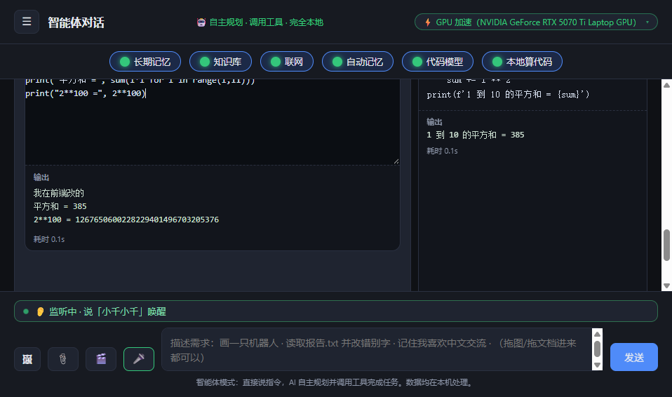
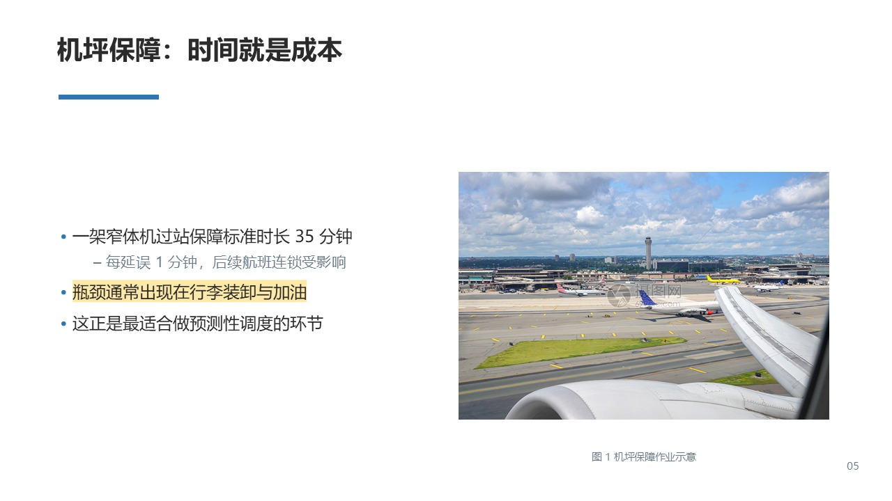
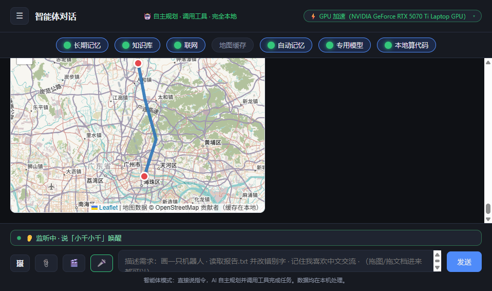
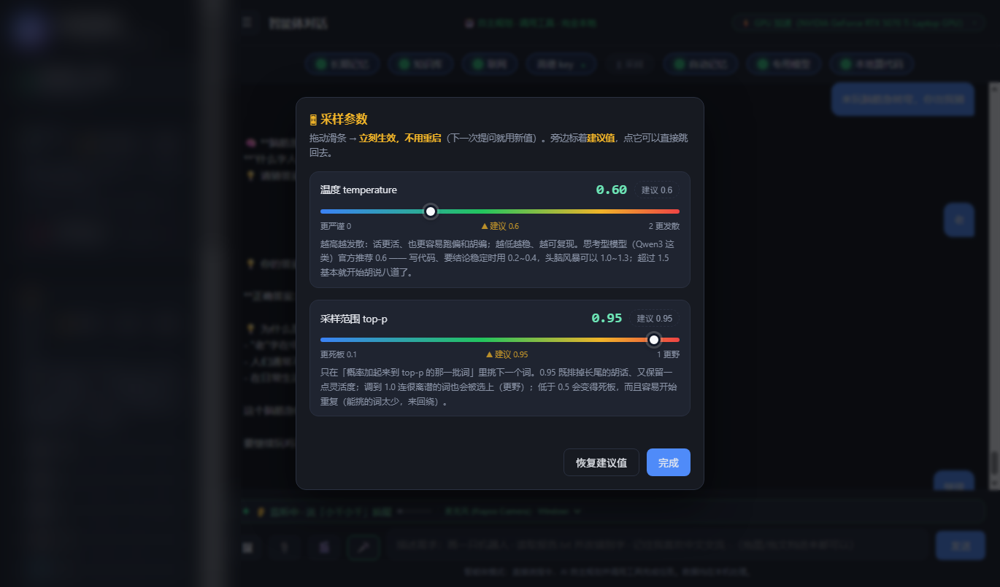
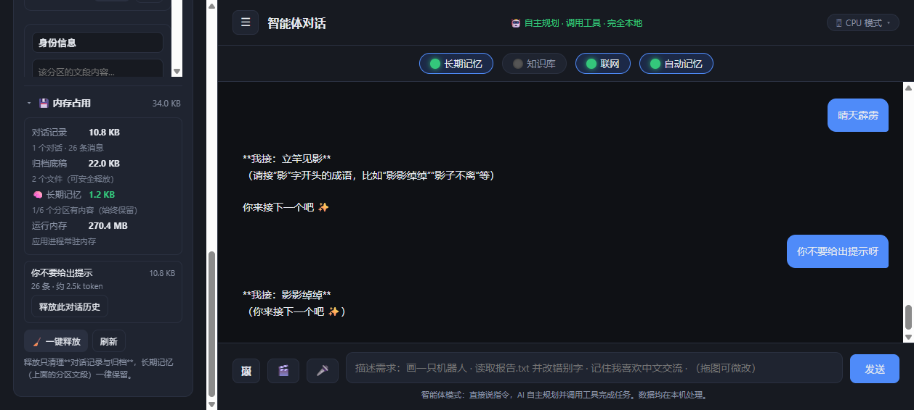

# Hardwordy Agent

**云端 AI 智能体 —— 会自己拆任务、调工具、改自己的源码；也能整体搬到本地跑**

55 个工具 · 技能编排 · 分层记忆 · 定时任务 · **能改自己源码的自我迭代** · 云端 / 本地双模




---

## 下载

| 版本 | 体积 | 说明 |
|------|------|------|
| **全量版**（分 2 卷） | **2.14 GB**（解压 3.2 GB） | 含**内置 VS Code**（code-server）与**抠图模型**（BiRefNet ×2）。解压后双击 `一键启动.bat` |
| **[轻量版](https://github.com/chenyt-Indom/hardwordy-agent/releases/download/v2026.11.08.3/LocalMultimodalAssistant-Windows-x64.zip)** | **194.8 MB** | 只有程序本体，体积小；开发台与抠图不可用 |
| 源码 | — | 见下方「快速开始」 |

**全量版（2026.11.11a · Hardwordy Agent）分两卷** —— GitHub 单文件上限 2 GB，所以切开：

- [`HardwordyAgent-Full-2026.11.11a.zip.part1`](https://github.com/chenyt-Indom/hardwordy-agent/releases/download/v2026.11.11/HardwordyAgent-Full-2026.11.11a.zip.part1) — 1.4 GB
- [`HardwordyAgent-Full-2026.11.11a.zip.part2`](https://github.com/chenyt-Indom/hardwordy-agent/releases/download/v2026.11.11/HardwordyAgent-Full-2026.11.11a.zip.part2) — 791 MB

**合并 + 校验**（Windows，CMD 或 powershell）：

```powershell
copy /b HardwordyAgent-Full-2026.11.11a.zip.part1 + HardwordyAgent-Full-2026.11.11a.zip.part2 HardwordyAgent-Full-2026.11.11a.zip

# 校验（应等于 98584f5e51de309ea8d87a332976e6a898381da022d48ace4b3db469a4ead5d3）
Get-FileHash .\HardwordyAgent-Full-2026.11.11a.zip -Algorithm SHA256
```

> macOS / Linux：`cat *.part1 *.part2 > HardwordyAgent-Full.zip`

> 两个包**都不含** AI 对话模型权重（由 Ollama 单独下载，18 GB / 6 GB）。
> 也**都不含**本地文生图（torch ~9 GB + SD 权重）——本地绘图在当前机器上不可用，
> 云端绘图正常。详见「已知限制」。

**装法（3 步）**

```powershell
# 1. 装 Ollama：https://ollama.com/download/windows

# 2. 下模型（18GB 主力 / 6GB 轻量）
ollama pull qwen3-vl:30b
# 或 ollama pull qwen3-vl:8b

# 3. 解压 zip → 双击 一键启动.bat（会自动查 Ollama、等端口、开浏览器）
```

详细说明见包内 **`INSTALL.md`**。

> **轻量版不含文生图**（需要 torch + Stable Diffusion 约 10 GB）。
> 其余功能全有：对话 / 图片理解 / 知识库 / 记忆 / 文件工具 / 联网 / 地图 / 语音 / **DeepSeek 双通道**。

---

## 这是什么

一个**能真正把事做完**的 AI 智能体 —— 不是只会回话的聊天框。

默认接 **DeepSeek V4.1**（云端），填个 Key 就能用；把模型切到本地 Ollama，它又能**整机离线运行，数据不出内网**。
同一套 Agent 内核，两种部署形态。

它和"套壳聊天"的区别在三点：

| | 普通套壳 | Hardwordy Agent |
|---|---|---|
| **有手** | 只会输出文字 | 55 个工具：读写文件、跑代码、搜网页、生成 PPT/Word/Excel、画图、查地图、控浏览器、定时任务 |
| **有记性** | 每次对话从零开始 | 分层记忆（短期/长期/项目）+ 会话检索 + 知识库 |
| **能改自己** | 不可能 | 自我迭代：改自己的源码 → 语法校验 → 失败自动回滚 → 重启生效 |

代码量 3.5 万行，其中一半的复杂度不在"调用模型"，而在**让模型安全地动真实文件和真实进程**。

如果你只有 30 秒：直接看 [技术难点](#技术难点) 那一节。

---

## 为什么做这个

起点是想验证一件事：**一个"能自己动手"的 Agent，到底需要多少基础设施？**

市面上两类产品各缺一半：纯聊天的不动手；绑死某个平台的，你的数据、你的工具、你的工作流都得搬过去。
所以干脆自己搭一套，把三件事都握在手里：

1. **模型可选**：云端（DeepSeek V4.1，能力上限高）⇄ 本地（Ollama，数据不出机器），顶栏一键切
2. **工具开放**：55 个工具都是本仓库的代码，想加就加，不用等平台排期
3. **能自我演进**：它改自己的源码，改坏了自动回滚 —— 这是"智能体"和"调用器"的分界线

**两种形态的成本对比**

|  | 云端模式（默认） | 本地模式（可选） |
|---|---|---|
| 前置投入 | 0（只填 Key） | 显卡（一次性） |
| 持续成本 | 按 token 计费 | 仅电费 |
| 能力上限 | 顶级模型 | 本地 8B~30B |
| 数据流向 | 出机器（走 API） | **不出机器** |
| 可用性 | 依赖网络 | **断网可用** |
| 适合 | 日常干活、复杂任务 | 内网、涉密、合规、长期高频 |

**定位一句话**：不是"又一个聊天壳"，而是**一套能带走的 Agent 内核** —— 云端用得起，本地也搬得动。

---

## 界面速览

**对话与工具卡片** —— 39 个工具按需自主调用，代码执行结果直接内联展示：


**本地绘图** —— Stable Diffusion Turbo 出图 + Real-ESRGAN 4 倍超分，全程离线（下图 2048×2048 为超分结果）：


**Office 文档生成** —— 直接产出可用的 pptx / docx / xlsx，自动配图、图注、页脚来源：



**地图与路线** —— 离线 OSM / 在线高德双模式，POI、路线、天气卡片：



**采样参数在线调节** —— 温度 / top-p 两条滑条，旁边标着建议值，拖完立刻生效：



**记忆与上下文占用** —— 长期记忆 1/6 分区、短期记忆按会话隔离，可一键释放：



---

## 它做出来过什么：创造自己想象中的智能体

> **创造自己想象中的智能体** —— 不是一个陪你聊天的输入框，
> 而是一个能自己决定用哪个工具、分几步、最后交出什么形态产物的东西。

下面这份 PPT 是**用本项目的云端通道（DeepSeek V4.1 Flash）生成的**：
没有模板、没有人工排版，结构、标题、每一页的内容都由模型自己决定。

| 产物 | 生成通道 | 体积 | 文件 |
|---|---|---|---|
| 《加沙：在废墟上寻找和平》 | 云端 · DeepSeek V4.1 Flash | 23 MB | **[下载 .pptx](docs/showcase/gaza-peace-deepseek-v41.pptx)** |

它走的也是同一套工具链：模型先定结构 → 逐页写正文 → 调用文档工具直接产出 `pptx`
→ 存进「生成文库」，前端给出下载入口。**全程只输入了一句自然语言需求。**

作者：**chenyt-Indom** · 广州民航职业技术学院 · 人工智能技术应用 · 2026 级

---

## 技术难点

这部分是这个项目的核心。下面每一节都是**真实踩过的坑**，不是教科书上的概念。

### 一、并行执行里的"副作用顺序"陷阱

**问题**：用户反馈"AI 建完项目，里面却是空的"。

**根因**：模型在同一轮里同时发起两个工具调用：

```
workspace_new_project   →  建项目，并把「当前项目」切过去
workspace_write         →  往「当前项目」写文件
```

工具是 `asyncio.gather` 同时开跑的。写文件可能在切项目之前就读到了旧的 `active_project`，文件于是落进了**上一个项目**。

**关键认知**：`asyncio.gather` 只保证「结果按原顺序合并」，**副作用早就以任意顺序发生了**。这是并发编程里最容易看走眼的地方——顺序看起来是对的，状态却是错的。

**解法**：对工具做依赖分级。

```python
_SERIAL_TOOLS = {
    "workspace_new_project", "workspace_use_project",
    "workspace_write", "workspace_mkdir", "workspace_delete",
    "workspace_move", "workspace_run", "run_python",
    "save_file", "library", "github_push",
}
_serial = any(n in _SERIAL_TOOLS for n, _a in calls)
```

- 本轮出现会改共享状态或依赖当前项目的工具 → **整轮串行**，顺序＝模型给出的顺序
- 纯读类（查知识库 / 联网 / 看时间）→ 仍然**并行**，不牺牲速度

并且每个工具用独立的 `ui_events` 列表，避免并发写入互相污染，最后按原序号合并，保证前端看到的次序稳定。

### 二、流式输出被"憋成一次性返回"

**问题**：明明开了 `stream=True`，前端却要等全部生成完才看到字。

**根因**：`requests.iter_lines()` 是**阻塞**的。直接在 asyncio 事件循环里读它，整个循环会被卡死，SSE 数据全堆在缓冲区里出不去。

**解法**：子线程阻塞读 + 队列传递。

```python
q: asyncio.Queue = asyncio.Queue(maxsize=256)

def _worker():
    for line in resp.iter_lines():
        asyncio.run_coroutine_threadsafe(q.put(line), loop)

threading.Thread(target=_worker, daemon=True, name="ollama-stream").start()
# 主循环： await q.get() —— 事件循环始终空闲，每来一块立刻推给前端
```

配合 `maxsize=256` 做**背压**：前端不消费时队列会满，停止读取，模型也就不会空转白烧显卡。

### 三、模型卸载重载导致"回答凭空消失"

**问题**：用户看到"模型加载一半、思考一半、没有回答"。

**根因**：Ollama 只要发现 `num_ctx` 与当前已加载模型不一致，就会**卸载并重载模型**（实测约 5 秒），而重载会中断正在进行的生成。后台的记忆提炼任务用 4096，聊天用 8192，于是：

```
聊天 → 记忆提取(触发重载) → 用户再发消息(又重载) → 生成被打断
```

**解法**：在最底层统一收口，而不是要求每个调用点自觉对齐。

```python
# num_ctx 一律取全局配置，忽略调用方传入的值。
# 与其要求每个调用点自觉对齐，不如在这里统一收口 ——
# 多一个调用点也不会再踩这个坑。
fixed_ctx = int(config.load_config().get("num_ctx") or 8192)
payload["options"]["num_ctx"] = fixed_ctx
```

这是一个设计决策：**把约束的强制点放在最靠近外部依赖的那一层。**

### 四、思考打转：重复段的检测与重试

**问题**：Qwen3-VL 偶尔在思考过程里原地打转（同一个例子反复推敲），把 `num_predict` 配额烧光，正文一个字都没写出来。

**分析**：`repeat_last_n` 是 Ollama 的防重复参数，**默认只有 64 个 token（约 40 个汉字）**——而打转是**段落级**的，重复段本身就 30~60 字，64 的窗口根本盖不住。

**解法**（三管齐下）：

1. **参数调整**：`repeat_penalty` 抬到 1.2，`repeat_last_n` 放大到 1024
2. **运行时检测**：`find_looping_piece(text, threshold=3)` 实时识别重复段
3. **加长重试**：检测到打转就作废本轮思考、加长输出上限重试（见 `test_thinking_retry.py`）

> ⚠️ 还有个坑：采样参数传 `None` 会**覆盖掉 Ollama 自己的默认值**（反而更糟），所以必须逐个判空后再传。

### 五、上下文预算的精确记账

`num_ctx` 这笔账要精打细算：

```
num_ctx = 系统提示 + 工具定义 + 历史 + 本轮输出 + 检索材料
           ↑写死      ↑写死     ↑可压缩   ↑预留      ↑动态
```

系统提示和 39 个工具的 schema 是固定开销，唯一能压缩的只有历史。而且：

```python
# 联网时，工具结果（8 条检索 + 若干篇网页正文）会在工具循环里追加进上下文，
# 此时还不知道具体多大 —— 按实测约 3600 token 预留，
# 否则「历史 + 检索材料」一起会撑爆窗口，Ollama 直接截断提示词。
search_reserve = 3800 if cfg.get("web_enabled") else 0
budget = ctx_limit - reserve_out - overhead - search_reserve - 512
```

丢掉的历史不直接扔——会压成「较早对话摘要」注入，否则用户回头问"开头聊了什么"，模型会一脸茫然（实测踩过）。

### 六、工具调用的双协议兜底

原生 Function Calling 是首选，但小模型在长上下文里经常不按 schema 出牌——该返回 `tool_calls` 的时候吐了一段文本。

所以做了双通道：

| 通道 | 触发 | 说明 |
|---|---|---|
| 原生协议 | 模型正常返回 `tool_calls` | 标准方式，`tool` 消息用 `tool_name` 关联 |
| 文本协议 | 模型把调用"写"成文本 | `_split_text_tool_calls()` + `_loads_lenient()` 容错解析 |

`_loads_lenient` 能容忍：尾部逗号、单引号、Markdown 代码块包裹、前后夹杂解释文字。

这个设计的意义：不是"兼容一下"，而是**让 Agent 在模型能力不足时不至于整体失效**。

---

## 架构

```
┌──────────────────────────────────────────────────────────┐
│  前端（原生 HTML / CSS / JS，8800 行）                     │
│  流式渲染 · 工具卡片 · 地图 · 文件树 · 语音状态             │
└────────────────────────┬─────────────────────────────────┘
                         │ SSE 流
┌────────────────────────▼─────────────────────────────────┐
│  FastAPI 后端                                             │
│  ┌───────────────────────────────────────────────────┐   │
│  │  对话主循环   main.py（5000 行）                    │   │
│  │  · 历史裁剪与摘要    · 工具循环（并行 / 串行调度）    │   │
│  │  · 流式转发          · 双协议解析                    │   │
│  └───────────────────────────────────────────────────┘   │
│                                                          │
│  工具层（39 个，tools.py 4000 行）                         │
│  ├─ 工作区    项目 / 文件 / 目录 / 代码执行                 │
│  ├─ 文档      pptx · docx · xlsx · Office 编辑            │
│  ├─ 知识库    索引 · 检索 · 多格式取文                      │
│  ├─ 地图      离线 / 在线双模式 · POI · 路线                │
│  ├─ 联网      多引擎并行搜索 · 网页正文                     │
│  ├─ 图像      文生图 · 图片微改 · 联网图搜                  │
│  └─ 记忆      长期 / 短期分层读写                           │
│                                                          │
│  基础能力                                                 │
│  ├─ Ollama 客户端（子线程阻塞读 + 队列）                    │
│  ├─ 记忆库     长期（15000 字）+ 短期（按会话隔离）          │
│  ├─ 语音       离线唤醒 sherpa-onnx                        │
│  └─ 工作区     沙箱化文件系统                              │
└────────────────────────┬─────────────────────────────────┘
                         │ 仅 127.0.0.1:11434
┌────────────────────────▼─────────────────────────────────┐
│  Ollama  ──→  Qwen3-VL-Think 30B（本地权重 19.6GB，Q4_K_M）        │
└──────────────────────────────────────────────────────────┘
```

---

## 双通道模型接入（本地 + 云端）

> 2026-11 新增：**同一套界面既能跑本地 30B，也能调 DeepSeek API**，前端下拉一键切换。

### 本地通道（默认）

- Ollama 本地推理，**数据不出机器**
- 默认 `qwen3-vl:30b`（18.2 GB，Q4_K_M）；显存不足时自动 offload（12GB 卡约 5–10 tok/s）
- 备选 `qwen3-vl:8b`（5.8 GB，30–50 tok/s）—— 显存够就能全量驻留

**模型下载管理**（状态卡片底部，三态互斥）

| 状态 | 界面 |
|------|------|
| 未安装 | 只显示 `⬇ 下载模型` |
| 下载中 | 只显示进度条（百分比 / 已下载 / 速度 / 剩余）+ `取消` |
| 已安装 | 只显示 `🗑 删除模型` |

- **后台线程下载**：不阻塞界面，浏览器不会 60 秒超时断开
- **断点续传**：取消后已下载的分片保留在 `ollama-models/blobs`，下次自动接着下
- **进度算法**：按 layer 累加（Ollama 的 `status` 是 `"pulling <digest>"`，不是 `"downloading"`，踩过这个坑）

### DeepSeek 通道

- 走 `https://api.deepseek.com`，**纯对话**（不支持本地工具：地图 / 工作区 / 画图）
- 支持三个模型（`/api/deepseek/models` 可查）：

  | 前端选项 | API model | thinking | reasoning_effort |
  |---|---|---|---|
  | DeepSeek V4.1 Flash | `deepseek-flash` | disabled | — |
  | DeepSeek V4.1（思考） | `deepseek-flash` | **enabled** | medium |
  | DeepSeek V4 Pro | `deepseek-v4-pro` | **enabled** | high |

> ⚠️ **2026-11 协议变更**：DeepSeek API 的模型名已从旧的 `deepseek-chat` /
> `deepseek-reasoner` 换成 `deepseek-flash`（由 DeepSeek-V4.1-Flash-1017 服务）/
> `deepseek-v4-pro`。**推理能力不再靠"换个模型"，而是靠请求体参数**：
> ```json
> {"thinking": {"type": "enabled"}, "reasoning_effort": "low|medium|high"}
> ```
> 本项目把"同一模型的思考/不思考"拆成两个下拉选项（`deepseek-flash` 与
> `deepseek-flash-think`），底层发的是同一个 model 名 + 不同的 thinking 参数。
- 右上角 **🔑 DeepSeek** 配置 Key，弹窗内直接给三个官方链接（创建 Key / 充值 / 查余额）

**Key 安全设计**

| 环节 | 做法 |
|------|------|
| 存储 | `sessionStorage`（关标签页即清空），**不写磁盘** |
| 传输 | `X-DeepSeek-Key` 请求头，**不进 URL / body / 日志** |
| 后端 | 只在请求作用域内使用，不写 `config.json`、不写日志文件 |
| 错误脱敏 | 所有错误信息过 `scrub()`，`sk-xxx` 一律替换成 `sk-***` |
| 输入框 | `type=password`，默认不显示明文，可点「显示」临时查看 |

**为什么单开一路 `/api/chat/deepseek`**

`/api/chat` 里是 Ollama 专用的工具循环 / 分层记忆 / RAG / 图片压缩，
DeepSeek 是 OpenAI 兼容的纯文本协议。硬塞进去要加一堆 `if`，容易碰坏原有逻辑。
两路独立、互不干扰，输出格式完全一致（NDJSON 行），前端渲染逻辑零改动。

### 相关接口

```
POST /api/chat/deepseek      流式对话（NDJSON，格式与 /api/chat 一致）
GET  /api/deepseek/models    可选模型清单 + 官方链接
POST /api/deepseek/check     校验 Key 并查余额（GET /user/balance）
POST /api/model/pull         启动后台下载（立即返回，不阻塞）
GET  /api/model/status       查询下载进度（前端 500ms 轮询）
POST /api/model/cancel       取消下载（保留已下载分片）
POST /api/model/remove       删除已下载模型
GET  /api/model/installed    已安装模型清单（含体积）
```

---

## 功能清单

<details>
<summary><b>点开看完整功能</b></summary>

**对话**
- 流式输出、思考过程可见、随时「终止」不占显卡
- **双通道切换**：本地 30B / 8B（Ollama）与 DeepSeek API 前端下拉一键切换；
  Key 只存 sessionStorage，不落盘、不进日志、不进 URL
- **模型下载管理**：进度条（百分比 / 速度 / 剩余）、取消续传、一键删除
- 模型可自主规划并调用工具，工具执行过程以卡片形式内联展示
- **随时「终止」**：发送键旁边的停止按钮，点了模型真的会停下

**看图 / 多模态**
- Qwen3-VL 原生多模态，拖拽图片直接问
- 图片微改（img2img）：描述"把背景换成夜晚"即可

**本地绘图**
- 文生图（SD-Turbo，4 步出图）
- 图片微改（img2img）
- 4 倍超分（Real-ESRGAN，512 → 2048）
- 界面可切换「自动 / GPU / CPU」，右上角徽章实时显示当前设备

**Office 文档**
- 生成 `.pptx` / `.docx` / `.xlsx`，反潮流地做得比较完整：
  封面、目录、角标、页脚来源、荧光笔标注、表格、图表、时间线、卡片、图文并排
- 也能**改现有文档**（`edit_office`）
- 生成完可直接在「文档库」里打开文件夹

**知识库**
- 支持 `.pdf` / `.docx` / `.xlsx` / `.pptx` / `.txt` / `.md` 自动识别入库
- 相关性检索，命中片段注入上下文

**地图与天气**
- 离线 OSM / 在线高德**双模式**，一键切换
- 地点搜索（高德含真实评分）、周边 POI、路线规划
- 天气数据走中国气象局

**联网**
- 多引擎并行搜索、网页正文抓取、图片搜索
- 一张「联网」开关总控；离线时不发任何请求

**记忆**
- **长期记忆**（全局，15000 字上限）＋ **短期记忆**（按会话隔离）
- 自动提炼，防抖 6 秒；可一键释放某段对话历史

**工作区**
- 沙箱化项目 / 文件管理，文件树、增删改
- 在工作区里跑 Python（支持 `input()` 交互）
- 打包 zip、GitHub 推送

**代码执行**
- 沙箱里跑 Python，实时输出
- 超时语义经过专门设计：**"跑不完"不等于"代码有错"**，长驻程序只做冒烟检测并如实说明

**语音**
- 离线唤醒词「小千小千」（sherpa-onnx，不联网）
- 流式识别，停顿自动发送
- 麦克风下拉 + 实时电平条，采不到声音看得见

**其它**
- 图片库 / 文档库，可预览、重命名、导出
- 采样参数在线调节（温度 / top-p，拖完立刻生效）
- Docker 一键部署（在线拉镜像 / 离线包两种模式）

</details>

---

## 自我迭代（让模型改自己的源码）

这是整套系统里最"危险也最有意思"的部分：模型可以**读自己的源码、改、重启自己**，改坏了能一键回退。

- **工具**：`selfdev_tree / grep / read(分页) / insert_after(锚点插入) / patch / write / apply(整文件重写) / restart / backups / rollback`
- **护栏**（都在后端，模型绕不过去）：
  - 语法校验：Python 写盘前 `ast.parse`、前端 `node --check`，不通过直接拒绝
  - 落盘前自动备份 + 改动日志，每次改动都是一个可回退的「版本」
  - 禁止改回撤机制自身；`data/` 等用户数据禁写
  - **🔓 完全访问开关**：关着只能改 `frontend/` 与新建文件，打开才允许动 `backend/*.py`
- **版本历史**：界面上每条版本可「看改动」，展开是逐文件 `+/-` diff（默认收起），也能整批「回撤」
- **看得见成果**：改完前端会**自动**截图，交给多模态模型看，把「哪里重叠 / 被裁切 / 横向挤压」作为工具结果回传，模型据此继续微调

> 实测：DeepSeek V4.1 能独立完成「grep 定位 → 读片段 → 锚点插入 → 自检 → 重启」全流程；
> 本地 8B 只能读到、落不了笔（会长时间打转）。所以自我迭代建议用云端代码模型。

## 性能与上下文（自动探测，不写死）

顶栏第三行直接可调，**日常聊天就生效**（不藏在自开发面板里）：

| 档位 | 输出上限 | 上下文 |
|------|---------|--------|
| 快速 | 8192 | 16k |
| 中等（默认） | 16384 | 40k |
| 高 | 32768 | 64k |
| 极高 | 65536 | 128k |

- **上下文可无极调节**：滑块 4k ~ 1M，默认跟随档位；输出下限 8192（不允许更低）
- **上限不是写死的**，启动时自动读当前模型的真实能力：
  - 本地：Ollama `/api/show` 的 `context_length`（qwen3-vl 实测 **262144**）
  - 云端：DeepSeek `/models` 的 `context_window`（V4.1 = **1048576**）与 `max_output_tokens`（**393216**）

## 部署到自己的服务器（Linux）

除了 Windows 打包版，同一套源码可以直接跑在 Linux 上（**不需要 GPU、不需要 Ollama**，走云端模型即可）：

```bash
# 1) 传代码 + 虚拟环境
rsync -av --exclude 'dist*' --exclude 'models' --exclude 'vendor' --exclude '.git' \
      ./ user@host:/opt/multimodal/
cd /opt/multimodal && python3 -m venv .venv
.venv/bin/pip install fastapi 'uvicorn[standard]' requests pillow python-multipart numpy \
      opencv-python-headless xlsxwriter python-docx python-pptx

# 2) Key 放进环境变量文件（600 权限，不进 git、不进 config.json）
sudo install -m 600 /dev/stdin /etc/multimodal.env <<< 'DEEPSEEK_API_KEY=sk-...'
```

systemd 单元的关键三行：

```ini
EnvironmentFile=-/etc/multimodal.env
Environment=MM_DISABLE_SELFDEV=1        # 公网部署务必打开
ExecStart=/opt/multimodal/.venv/bin/python -m uvicorn backend.main:app --host 0.0.0.0 --port 5000
```

- **`MM_DISABLE_SELFDEV=1` 会把「自我迭代」整块锁掉**：`selfdev.read/write` 直接拒绝、工具层统一拦截、前端自动隐藏 🛠 与 🔓 入口。理由很直接——`/api/selfdev/*` 能改服务器源码、重启服务，公网无鉴权时等于把 shell 挂出去。
- Key 的取值顺序是 **请求头 > 环境变量**：所以同一个服务既能给"自己填 Key"的人用，也能给"服务器统一托管 Key"的场景用。
- nginx 反代务必加 `proxy_buffering off`，否则流式会被攒成一坨再吐。

## 手机端

同一套前端做了窄屏适配（≤768px），电脑和手机共用一个地址：

- 侧栏变抽屉、默认收起（点左上角 ☰ 打开）
- 顶栏默认收起，点「▸ 展开」才拉开；每行控件横向滑动，不再折成半屏
- 气泡占满宽度，输入框/图标按钮按屏收紧
- **思考过程默认展开并逐字刷新**（桌面端仍默认折叠，点标题展开；手机端超 500 字自动折回）
- **微信内置浏览器（X5）会缓冲 `fetch` 的流式响应** → 检测到 `MicroMessenger` UA 时改走 `XHR.onprogress` 增量读取；连 `resp.body` 都没有的内核则整段读取后回填，至少保证内容出得来

## 已知限制

- **本地文生图不可用**：需要 torch（~9 GB）+ Stable Diffusion 权重，两者都不在发布包里。
  开发机上 torch 的 `shm.dll` 还会被系统策略拦截（`PermissionError`），且本机没有任何 SD 权重文件。
  → **云端绘图可用**（🎨 图片 → 云端模型）。
- **轻量版**（194.8 MB）不含 code-server 与抠图模型，对应功能不可用；要完整体验请下全量版。
- **本地 8B 做不了自我迭代**：能对话、能看图，但改代码会卡在"只读不写"，需切 DeepSeek。
- **微信内置浏览器的流式仍可能被缓冲**：已用 XHR 绕过大部分情况，但如果发现"整段才出现"，
  换手机自带浏览器 / Chrome 打开同一地址即可（标准 `fetch` 流式）。

## 快速开始

### 方式一：Windows 一键包（推荐）

下载 **[轻量版](https://github.com/chenyt-Indom/hardwordy-agent/releases)**（Release 页里约 195 MB 那个）→ 解压 → 双击 `一键启动.bat`。

语音功能需额外下载 **[asr-model-zh-14M-int8.zip](https://github.com/chenyt-Indom/hardwordy-agent/releases)**（约 20 MB），解压到 `_internal/asr_model/`。

### 方式二：源码运行

```bash
# 1. 安装 Ollama
#    https://ollama.com   （或 winget install Ollama.Ollama ）

# 2. 拉取模型（约 19.6GB，只需一次）
ollama pull qwen3-vl-think:30b
# 写代码用的另一个模型（约 18.6GB，可选）
ollama pull qwen3-coder:30b

# 3. 安装依赖
pip install -r requirements.txt

# 4. 启动
python run.py
```

浏览器自动打开 <http://127.0.0.1:8000>。

### 方式三：Docker（离线部署）

双击 **`一键部署.bat`**

脚本会自动：检查引擎 → 探测宿主机 Ollama（有则直连、零下载）→ 导入离线镜像 → 启动 → 健康检查 → 打开浏览器。

RTX 50 系显卡需用 cu130 重建：`--build-arg TORCH_INDEX=https://download.pytorch.org/whl/cu130`

> 也可以从镜像仓库部署（不用拷 58GB 交付包），见 [`docker/从镜像仓库部署.md`](docker/从镜像仓库部署.md)。

---

## 环境要求

| 项目 | 要求 |
|---|---|
| 操作系统 | Windows 10 / 11（Linux / macOS 可手动运行） |
| 显卡 | NVIDIA 独显（**强烈建议**，显存 ≥ 12GB）；没显卡也能跑，但慢约 60 倍 |
| 内存 | ≥ 32GB（12GB 显存装不全 30B 权重，一部分要走内存） |
| 硬盘 | ≥ 90GB（模型约 50GB；Docker 部署另需数据盘空间） |

**性能参考**（RTX 5070 Ti Laptop **12GB**，实测）：冷启动加载约 20 秒，热态首字 **0.07 秒**，生成速度约 **25 字/秒**。
> 换过图/换过模型后第一条消息会重载模型（约 20 秒），之后就是热的 —— 对话模型保活 4 小时。

> 显存不足时把 `config.json` 里的 `num_ctx` 调低（如 8192 或 4096）。

---

## 测试

**13 个测试脚本，约 3300 行**，每个都对应一个真实修过的 bug：

| 脚本 | 验证什么 |
|---|---|
| `test_smoke.py` | 工具注册完整性（schema / append / dispatch / 实现函数四处对齐）+ 全工具实跑，在临时数据目录中运行，不污染用户库 |
| `test_loop.py` | 思考打转检测与修复；采样参数是否真的进了请求体 |
| `test_thinking_retry.py` | 重试时必须作废上一轮思考 |
| `test_text_tool_leak.py` | 工具调用泄漏成代码卡片（```tool 围栏 / `<function-call>` 包装 / 裸 JSON / 半截标签）、`input()` 无法输入 |
| `test_tool_leak_e2e.py` | 起一个**存根 Ollama** 强制吐出三种泄漏写法，验证"用户一个字都看不到 + 工具真的被执行了" |
| `test_tool_leak_frontend.mjs` | 前端最后一道闸 `stripToolLeak`（把 app.js 里的函数**原样抠出来**跑用例） |
| `test_run_timeout.py` | 执行超时被强杀后，**不能让模型误以为自己的代码写错了** |
| `test_memory_extract.py` | 长期记忆提炼的取舍口径：该记的记、不该记的不记 |
| `test_voice.py` | 唤醒不灵敏、识别重复字（"小千小千"→"小小千小千千"） |
| `test_map_offline.py` | 离线模式**一个网络请求都不发**（用 urlopen 钩子实测，不靠肉眼看看代码） |
| `test_mode_switch.py` | 联网 / 离线来回切换 |
| `test_weather.py` | 天气数据源契约 |
| `test_sampling_ui.mjs` | 采样面板浏览器端到端（CDP 驱动无头浏览器**真点**，不靠读代码） |

```bash
python test_smoke.py       # 无需启动应用
python test_loop.py
```

**测试设计原则**：优先验证"没法靠跑一遍应用看出来"的东西。

比如记忆提炼是后台跑的、有防抖、还慢——跑一遍界面根本验证不了，只能写测试。

---

## 项目结构

```
.
├── backend/
│   ├── main.py            对话主循环、路由、流式、工具调度
│   ├── tools.py           39 个工具的定义与分发
│   ├── ollama_client.py   Ollama 客户端（流式）
│   ├── memory.py          长期 / 短期分层记忆
│   ├── kb.py              知识库索引与检索
│   ├── workspace.py       沙箱化工作区
│   ├── doc_extract.py     多格式取文
│   ├── docx_maker.py      ┐
│   ├── xlsx_maker.py      ├ 文档生成
│   ├── pptx_maker.py      ┘
│   ├── map_tools.py       地图（离线 / 在线）
│   ├── web_tools.py       联网搜索
│   ├── t2i.py             本地绘图
│   └── voice.py           离线语音
├── frontend/              原生 HTML / CSS / JS
├── docker/                Docker 构建与部署
├── build/                 PyInstaller 打包
├── scripts/               一键脚本
├── releases/              发布包
└── test_*.py / *.mjs      13 个测试脚本
```

---

## 设计取舍

**1. 为什么完全本地，不做"本地优先 + 云端兜底"？**

因为目标场景（内网部署）下，"兜底"本身就是违规的。只要存在一条通往公网的调用路径，这个方案在政企内网里就不可用。所以宁可牺牲一部分能力上限，也要保证**架构上不存在任何外部依赖**。

**2. 为什么不用 LangChain / LlamaIndex？**

因为需要**精确控制**。工具循环的串行/并行判定、上下文的逐项记账、流式的背压处理——这些在框架里要么做不到，要么得改源码。3.5 万行里有一大半是在处理框架不管的边界情况。

**3. 为什么用文本协议兜底？**

因为本地 30B 模型的能力边界很明确。原生 Function Calling 在长上下文里会失效，如果不兜底，整个 Agent 就废了。加一层容错解析，换来的是"降级可用"而不是"整体崩溃"。

---

## Roadmap

- [ ] 拆分 `main.py`（当前 5000+ 行，计划把对话主循环独立成模块）
- [ ] 引入 pytest + GitHub Actions CI
- [ ] 补一份内网部署文档（环境要求 / 数据落盘位置 / 离线安装流程）
- [ ] 把踩坑记录整理成独立文档

---

## 作者

**chenyt-Indom**
广州民航职业技术学院 · 人工智能技术应用 · **2026 级**

主要方向：AI 应用开发 / 多模态与 Agent / 本地化部署

GitHub：[@chenyt-Indom](https://github.com/chenyt-Indom)

---

## License

- 本工具：**Apache 2.0**
- 模型 Qwen3-VL-Think 30B / Qwen3-Coder 30B：**Apache 2.0**（免费商用）

---

## 更多文档

| 文档 | 内容 |
|---|---|
| [`docs/使用手册.md`](docs/使用手册.md) | 详细使用说明、参数说明、常见问题 |
| [`docs/源码导读-新手版.pdf`](docs/源码导读-新手版.pdf) | **源码导读 · 新手版**（19 页）：先补 5 个概念 → 逐段讲 `run.py` / `app.js` / `main.py` / `deepseek_client`，每段都有「这是什么 → 逐行在干什么 → 它和谁有关」+ 4 个动手实验 |
| [`docs/阅读攻略.pdf`](docs/阅读攻略.pdf) | **速查版**（5 页）：3 天路线 + 行号锚点，适合已读完新手版后回查 |
| [`docker/使用说明.md`](docker/使用说明.md) | Docker 部署、显卡适配、离线包说明 |
| [`docker/从镜像仓库部署.md`](docker/从镜像仓库部署.md) | 只拿镜像地址时的部署方式 |
