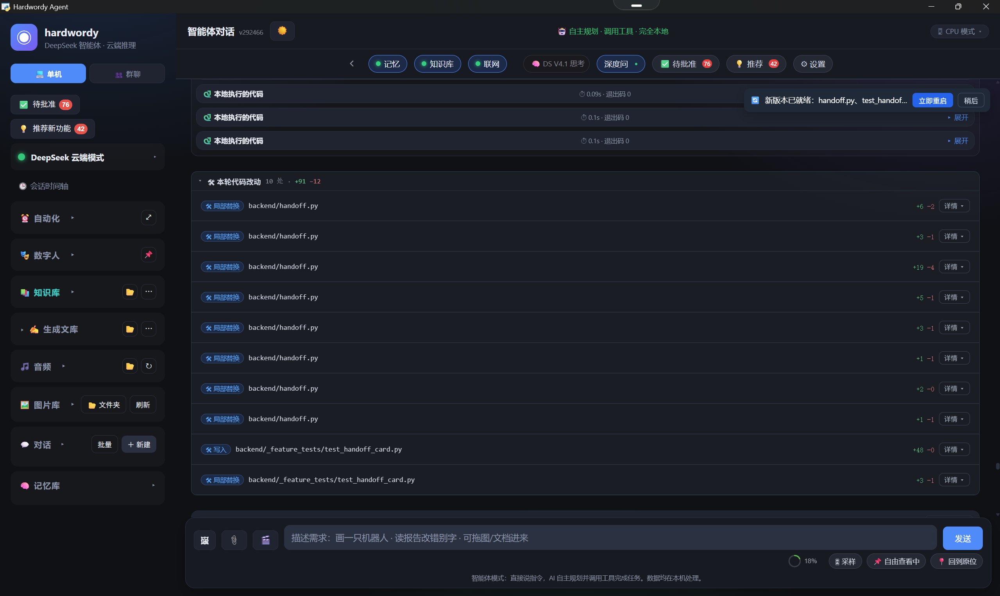

# Hardwordy Agent

### 一个在生产环境中长期运行的自迭代本地智能体系统

*A Long-Running Self-Iterating Local Agent System in Production*

陈宇桐　·　广州民航职业技术学院，人工智能技术应用　·　2026 年 11 月


> 本文档按学术论文结构组织。逐项功能说明与安装指南见 [`README_产品版.md`](./README_产品版.md)。

---

## 摘要

本文描述 Hardwordy Agent，一个以桌面应用形态长期运行的本地多模态智能体系统，其核心特征是能够在无人工干预下修改自身源码并持续部署。系统以"五通道"自迭代架构组织，通过受限工具集（8 个工具、80 步预算）执行代码修改，并在写盘前后设置四道相互独立的质量闸：静态审计（19 项，以 AST 为主）、子进程重导入回归、结构快照差分、四轮换方法复核（三态判定）。同时以四层修改防护（整文件白名单、目录白名单、片段逐字锁、语义角色记账）与五层回滚链路（单文件备份、全栈快照、外部镜像 896 份、独立恢复脚本、启动闸门）保证自修改失败时系统仍可恢复。

截至 2026-11-18，仓库累计 2,600+ 次提交（当日实测 2,655）；backend 86,000 行、frontend 28,267 行（合计 11.4 万行）；359 个 HTTP 路由；67 个工具。提交数随自迭代每日增长，故取量级而非精确值；本文其余统计均为同一时点快照。

本文同时报告一项**负面结果**：由于缺少不可被智能体自身修改的冻结基准，本系统的"自我改进"目前**不可证伪**。近 7 天内 2,336 条自迭代动作中有 2,309 条（98.8%）由智能体自产，但该数字只表明活跃度，不表明能力提升。我们在 6.2 节报告三类已观察到的失效模式，其中两类正是自迭代产出的低质量结果；在 6.3 节论证它们有同一个根因。据此本文认为，该架构最优先的后续工作不是增加通道，而是引入外部基准与受控对照（9.1 节）。

**关键词**：自修改智能体；递归自我改进；代码生成质量保障；可回滚部署

---

## 1. 引言

### 1.1 问题

大语言模型智能体的能力边界在过去两年从"调用工具"扩展到"修改自身"。这一扩展带来一类新的工程问题：**当智能体能够重写自己的源代码时，如何保证它不会把自己改成一个不可用、不可审计、不可恢复的状态？**

现有研究已在方法论层面给出回答。Darwin Gödel Machine（DGM）用进化归档加经验验证替代形式化证明 [1]；SICA 取消元智能体与目标智能体的区分，让单一智能体直接改写自身脚本 [2]；Gödel Agent 在运行时用 monkey-patching 替换自身逻辑，并配验证器检查不变量 [3]；MOSS 与配套的 Ratchet 把源码级重写形式化为带单调改进保证与回滚机制的安全层 [4,5]；AlphaEvolve 则在算法搜索空间取得可量化的生产收益——为 Google 回收 0.7% 的全球算力 [6]。

这些工作共同确立了一个范式：**执行 → 评估 → 改写源码 → 验证 → 部署或回滚**。本文不再重复论证该范式的有效性。

### 1.2 本文的立场

上述系统都是研究原型：它们在受控基准上运行固定轮次后终止。本文关注另一个问题——**当同一个循环在生产环境中连续运行数月、且唯一用户就是开发者本人时，会暴露哪些在实验环境里不会出现的问题？**

这个问题的答案不在方法论层面，而在工程层面。研究原型不需要回答"改坏之后用户还能不能把程序启动起来"，因为实验跑完就结束了；一个每天被使用的桌面应用必须回答。本文全部注意力集中于此。

### 1.3 贡献

1. **一套面向长期运行的自迭代工程架构**：五通道分工、受限工具集、四道独立质量闸，以及它们各自对应的失效假设（第 4 节）。
2. **四层递进的修改防护**：从整文件拒绝、目录拒绝、片段逐字比对到语义角色记账，覆盖不同的绕过路径（5.1 节）。
3. **一条完整的回滚链路**：包含"程序已经起不来"这一最坏情况下的独立恢复通道（5.2 节）。
4. **三类已观察到的失效模式**及其根因分析（6.2、6.3 节），其中"自评指标的数据源为空"具有普遍性。
5. **一项负面结果**：论证在缺少冻结基准时，自迭代系统的改进声明不可证伪，并说明这如何反向影响架构设计（第 7 节）。

---

## 2. 相关工作

### 2.1 三条技术路线

自我改进研究可按"修改什么"分为三条路线。

**权重更新。** 在智能体自己生成的数据上微调基础模型（如 SEAL、DSPy 的 BootstrapFinetune）。改动不可读、不可回滚，审计成本最高。

**记忆与技能累积。** 不改模型也不改代码，只把经验写成可复用的技能或反思（Reflexion [7]、Voyager [8]）。成本最低、最安全，但能力上限受限于"下一次能否检索到"。

**源码重写。** 直接编辑智能体自己的源代码文件。能力上限最高，风险也最高。本文属于这一路线。

### 2.2 定位

**表 1**　与前沿工作的定位对比

| 工作 | 修改对象 | 评估依据 | 安全机制 | 部署形态 |
|---|---|---|---|---|
| Reflexion [7] | 自然语言反思 | 任务成功率 | 无 | 研究 |
| Voyager [8] | 技能库（JS 代码） | 任务完成 | 无 | 研究 |
| AlphaEvolve [6] | 算法代码 | 客观基准分数 | 沙箱 | Google 内部生产 |
| DGM [1] | 智能体源码 | SWE-bench / Polyglot | 归档 + 沙箱 | 研究（80 轮终止） |
| SICA [2] | 智能体脚本 | SWE-bench Verified | 无显式机制 | 研究 |
| Gödel Agent [3] | 运行时逻辑 | 任务效用函数 | 验证器检查不变量 | 研究 |
| MOSS + Ratchet [4,5] | Python/TS 源码 | 自动化测试套件 | 单调改进保证 + 回滚 + 审计 | 研究 |
| **本工作** | **桌面应用全栈源码** | **自评（无冻结基准）** | **四层防护 + 回滚 + 审计** | **单机生产，持续运行** |

两处差异值得强调。

**其一，评估依据是本文最大的弱点。** 表中其余系统都有智能体无法修改的评估物：DGM 用 SWE-bench，MOSS 用独立测试套件，AlphaEvolve 用可执行基准。本文的评估物（`backend/_feature_tests/` 与 `regress.py` 的断言）**位于被修改的代码库内部**——虽然在防护层中被划为只读，但"只读"本身也由代码实现。这是结构性弱点，第 7 节展开。

**其二，部署形态是本文唯一明确的优势。** 其余系统在实验结束后停止，"长期运行中不失效"这一属性无法在它们的设定下被测量。

---

## 3. 系统概览

### 3.1 运行形态

单进程桌面应用：`run.py` 在后台线程启动 FastAPI（uvicorn），再用 pywebview 弹出内嵌窗口加载本地前端。推理走本机 Ollama（默认 `qwen3-vl:30b`，MoE，30.5B 总参 / 3.3B 激活），代码生成可切换至云端 DeepSeek。全程可离线运行。



*图 1　自迭代执行后的界面形态。中部列出本轮自动产出的 10 处代码改动（含逐条增删行数与详情入口）；顶部为工具调用卡片与「新版本已就绪」提示——后者对应 5.2 节的重启流程，新代码写盘后需重启进程才生效，提示条给出「立即重启 / 稍后」两个出口。*

### 3.2 模块划分

**表 2**　核心模块规模与职责

| 模块 | 行数 | 职责 |
|---|---|---|
| `backend/main.py` | 15,789 | HTTP 路由层（359 个端点）与对话主循环 |
| `backend/tools.py` | 7,766 | 67 个工具的注册与执行 |
| `backend/self_iterate.py` | 6,892 | 自迭代主流程：反思、计划、审批、执行 |
| `backend/iter_agent.py` | 1,544 | 受限工具集（8 工具 / 80 步） |
| `backend/code_audit.py` | 1,554 | 静态审计（19 项检查） |
| `backend/regress.py` | 740 | 行为回归（子进程重导入） |
| `backend/reverify.py` | 598 | 四轮换方法复核 |
| `backend/selfdev.py` | 1,613 | 补丁应用、备份、片段锁 |
| `backend/bootgate.py` | 241 | 重启来源判定与熔断 |
| `rescue.py` | 1,975 | 独立恢复工具（仅标准库） |
| `frontend/app.js` | 15,875 | 前端主逻辑 |

### 3.3 状态分层

系统把状态分为三类，这是自迭代能够安全运行的前提（表 3）：

**表 3**　状态分层

| 层 | 位置 | 可写性 | 内容 |
|---|---|---|---|
| 只读资源 | `sys._MEIPASS` 或项目根 | 否 | 前端、模型权重 |
| 可写数据 | `data_root()`（可由 `MM_DATA_DIR` 覆盖） | 是 | 会话、记忆、配置、账本 |
| 外部镜像 | `%LOCALAPPDATA%\LocalMultimodalAssistant\rollback` | 是（但模型工具写不到） | 版本备份，896 份 |

外部镜像位于项目目录之外，是整条回滚链路里唯一"即使代码被改烂也还在"的一环。

---

## 4. 方法

### 4.1 五条通道

自迭代不是一个循环，而是五条触发条件与职责都不同的通道。分开的理由是：不同类别的改进需要不同的证据门槛（表 4）。

**表 4**　五条通道的分工

| 通道 | 触发 | 职责 | 关键约束 |
|---|---|---|---|
| `self_iterate` | 用户点击 / 定时 | 反思 → 计划 → 审批 → 执行 | 单动作 ≤3 文件（功能类 ≤6） |
| `selfloop` | 事件驱动 | 低风险自维护 | 日配额 12、最小间隔 90s、积压上限 30 |
| `featradar` | 定时 | 从外部信息源发现功能缺口 | 只产出提案，不改代码 |
| `selfevolve` | 定时 | 自我评估与弱点识别 | 产出 weakness 列表 |
| `selfmaint` | 定时 | 清理、归档、健康检查 | 不触碰源码 |

把"发现问题"与"修改代码"分离，是为了让提案阶段可以宽（多产），执行阶段必须窄（低风险）。

### 4.2 受限工具集

执行阶段不启用完整的 67 工具，而使用一个只有 8 个工具的子智能体（`iter_agent`）：`read_file`、`write_file`、`edit_file`、`list_dir`、`grep`、`run_cmd`、`check`、`finish`。预算 80 步。

收窄工具集的理由不是安全，而是**可验证性**：工具越少，事后复核能覆盖的比例越高。`_final_verify` 会在智能体声明完成后重新读取被修改的文件并聚合核对，而不是采信它的自我报告。

`check` 工具用于在循环内提供即时反馈（跑一次断言），避免错误累积到最后才被发现。

### 4.3 四道质量闸

四道闸不是冗余，它们各自拦截**不同类别**的错误（表 5）：

**表 5**　四道质量闸与各自拦截的错误类别

| 闸 | 检查方式 | 拦截的错误类别 |
|---|---|---|
| `code_audit` | AST 分析为主，19 项规则 | 语法正确但语义错误（未使用导入、吞异常、硬编码密钥、subprocess 未走封装） |
| `regress` | 子进程重新导入并跑断言 | 导入成功但行为改变（模块级副作用、全局状态污染） |
| `snapdiff` | 结构快照差分 | 行为未变但结构漂移（符号被删、签名改变） |
| `reverify` | 四轮换方法复核，三态输出 | 结论由模型自己给出且未经独立验证 |

两个设计选择值得说明。

**`regress` 必须使用子进程。** 在同一进程内重新导入模块时，Python 的模块缓存会使检查失效——`importlib.reload` 无法完整还原被替换的全局状态。实测把 `regress.py:583` 改为同进程调用后，一类"删掉某个全局常量"的改动不再被检出。子进程是唯一可靠的方案，代价是每次约 1.2 秒。

**`reverify` 输出三态而非二值。** `verified` / `inconclusive` / `rejected`。原因是没有 API Key 时无法做语义复核（LLM 采样两次），此时若强行二值化，会把"未验证"误报为"验证通过"。三态把不确定性显式暴露，代价是调用方必须处理中间态。

### 4.4 归因：fail_kind 账本与幽灵闸

自迭代的一个真实失效模式是**幽灵修复**：模型凭空构造一个"已发生的失败"，再编写代码去修它。这类动作不仅浪费轮次，还会改坏本来正常的代码。

对策是在动手前查询账本：按 `fail_kind` 统计近 7 天真实出现次数，为 0 则拒绝。项目内有两套实现（表 6）：

**表 6**　两套幽灵闸实现

| 实现 | 位置 | 数据源 | 状态 |
|---|---|---|---|
| `_check_failure_evidence` / `_require_real_failure` | `selfdev.py:147` / `:188` | `actlog.jsonl`（提案自带 fail_kind） | 有效 |
| `_check_phantom` | `self_iterate.py:4522` | `task.json` 的 `events[*].fail_kind` | **见 6.2 节** |

---

## 5. 工程保障

### 5.1 四层修改防护

单一白名单不足以覆盖所有绕过路径，因此采用四层递进防护，粒度由粗到细（表 7）：

**表 7**　四层修改防护

| 层 | 机制 | 粒度 | 越界后果 | 当前覆盖 |
|---|---|---|---|---|
| 1 | `PROTECTED` | 整份文件 | 拒绝写盘 | `selfdev.py`、`restore.py`、`回滚救急.bat` |
| 2 | `_GUARD_FILES` / `_GUARD_DIRS` | 整份文件 / 目录 | 工具层拒绝 | `selfdev.py`、`regress.py`、`iter_agent.py`、`_feature_tests/` |
| 3 | `_LOCKED_BLOCKS` + `_check_locked_blocks` | 代码片段（`LOCK`…`END` 标记） | 逐字比对，内容变化即拒绝 | `frontend/app.js` 两处 |
| 4 | `audit_tamper` / `classify_tamper` | 语义角色 | 只记账，不拦截 | `backend/` 全量 |

**片段锁的必要性**来自一个具体故障：`frontend/app.js` 里有两处代码，改错会导致所有 `{error, __end}` 事件被整条吞掉，界面直接变白且极难定位。这两处不值得整文件锁死（其余部分仍需被迭代），因此采用逐字比对——只锁区块，文件其余部分照常可改。

还有一个必须处理的细节：同名区块可能在同一文件出现多次。早期实现用 `.find()` 只取第一处，导致第二处完全不受保护。`_extract_all_locked` 改为逐处收全，数量不对或任何一处内容变化都拒绝。

### 5.2 回滚链路

五层依次覆盖上一层失效的情况：

1. **单文件备份**：每次写盘前，`selfdev._backup()` 存一份到 `data/self_backups/`。
2. **全栈快照**：每批迭代动手前建 `it_` 前缀快照，可整体还原。
3. **外部镜像**：`selfdev.mirror_dir()` 写到项目目录之外，累计 896 份。模型的所有工具都越不过目录边界，因此这一层在"代码已被改烂"时仍然有效。
4. **独立恢复脚本**：`rescue.py`（1,975 行，仅标准库，不 import `backend`）。它不依赖任何可能被改坏的模块——如果它 import 了 `backend`，那么在 `backend` 被改坏时它自己也会起不来。
5. **启动闸门**：`bootgate.py` 判定重启来源并熔断（5 分钟内 3 次），防止"自检失败 → 重启 → 又失败"的无限套娃。

`rescue.py` 的设计约束全部来自失败经历：只用标准库、不 import backend、单实例锁（防止两个恢复进程同时改写同一目录）、`project_id` 校验（防止对错误的目录执行恢复）、逐文件 sha256（只回滚真正变化的文件）、大规模删除保护（一次删除超过阈值即中止）。

### 5.3 重启闸门

自迭代经常需要重启进程才能让新代码生效。但"重启"与"崩溃"在外部观察上是同一件事，若不在启动时区分来源，就会出现无限重启。

`bootgate` 维护一张重启来源判定表（用户主动 / 迭代请求 / 崩溃恢复 / 未知），并限制 5 分钟内最多 3 次。超过即进入安全模式，不再执行任何自迭代动作。

---

## 6. 观察

本节报告**描述性统计**，不是受控实验。用途是说明系统规模与失效模式，不能作为能力提升的证据（见第 7 节）。

### 6.1 规模

**表 8**　系统规模（描述性统计，非受控实验）

| 指标 | 数值 | 采集方式 |
|---|---|---|
| 提交总数 | 2,600+（2026-11-18 实测 2,655） | `git rev-list --count HEAD` |
| backend 行数 | 86,000 | `wc -l backend/*.py` |
| frontend 行数 | 28,267 | `wc -l frontend/*` |
| 根目录脚本行数 | 11,277 | `wc -l *.py` |
| HTTP 路由 | 359 | `@app.{get,post,put,delete}` 计数 |
| 工具数 | 67 | `tools.py` 注册表 |
| 外部镜像备份 | 896 | 镜像目录文件计数 |
| 近 7 天自迭代动作 | 2,336 | `actlog` 统计 |
| 其中智能体自产 | 2,309（98.8%） | 同上 |

### 6.2 已观察到的失效模式

以下三类问题均由静态审查与运行时核对发现，且**都出现在自迭代产出的代码里**。它们共同说明"高自产率"与"高质量"是两件事。

**失效模式 A：自评指标的数据源为空。**

`_check_phantom`（`self_iterate.py:4522`）按 `fail_kind` 统计近 7 天出现次数，数据源是 `data/self_iterate/task.json` 的 `events[*].fail_kind`。而写入该文件的是 `iter_runner.py:81` 的 `_emit()`，其字段集为 `seq / tid / kind / ts / t` 加调用方传入的关键字参数——**没有任何调用点传入 `fail_kind`**。

实测备份账本 `_verify_bk/task.json`：141 条事件，含 `fail_kind` 的 **0 条**。

因此 `count_fail_kind_ex` 恒返回 `(0, True)`，`n <= 0` 恒成立，**每一个带 `fail_kind` 的动作都被判定为幽灵**。注意失效方向：这不是"该拦的没拦住"，而是"错误地全部拒绝"。它不会让坏代码进入，但会让执行队列整体停摆。

根因是项目内存在两套幽灵闸，各读不同的账本文件：`selfdev.py` 那套读 `actlog.jsonl`（有效），`self_iterate.py` 那套读 `task.json`（字段为空）。新增机制时未核对数据源是否真的被写入。

**失效模式 B：配置项未接线。**

`config.py` 定义 52 个配置键，扫描全项目 210 个 `.py` 后发现 6 个键**没有任何读取点**：

**表 9**　未接线的配置键

| 键 | 配置值 | 实际生效值 | 生效位置 |
|---|---|---|---|
| `web_top_k` | 4 | 10 | `tools.py:3368` |
| `memory_top_k` | 5 | API 8 / 工具 5 | `main.py:11352` / `tools.py:7760` |
| `max_reply_chars` | 4000 | 6000 | `main.py:502` |
| `circuit_break_threshold` | 10 | 10（一致） | `self_iterate.py:934` |
| `api_tools` | `[]` | 未实现 | — |
| `code_backend` | `"deepseek"` | 已被 `code_model_choice` 取代 | — |

界面能改、能保存，但改了没有效果。前两项的默认值与实际值**本身就不一致**（4 对 10、4000 对 6000），说明"接线"这一步从未被验证。

**失效模式 C：防护层存在绕过路径。**

`PROTECTED`（`selfdev.py:282`）声明 3 个受保护文件，但它只在 `selfdev.patch` 入口生效。`iter_agent` 的 `write_file` / `edit_file` 直接调用 `Path.write_text()`，不经过 `selfdev.patch`，因此不检查 `PROTECTED`、不检查片段锁、不写审计账本、不建备份。

实际暴露面比表面上小：`_norm_rel` 只允许 `backend/` 与 `frontend/` 前缀，且扩展名限 `.py/.js/.css/.html`，因此根目录的 `restore.py` 与 `.bat` 文件改不到。真实可被绕过的只有 `backend/bootgate.py`、`code_audit.py`、`reverify.py` 三个文件，以及 `app.js` 的两处片段锁。

另有一处名单与实际不符：`PROTECTED` 里写的是 `回滚.bat`，项目根的实际文件名却是 `回滚救急.bat`。该条目实际失效，只因为 `.bat` 不在扩展名白名单内，才被第二道防线顺手挡住。

### 6.3 三类失效的共同根因

A、B、C 的根因是同一个：**新增机制时只验证了"代码能跑"，没有验证"这条路径真的被走到"。**

- A 新增了归因闸，但未验证数据源有数据；
- B 新增了配置键，但未验证消费端读取了它；
- C 新增了保护名单，但未验证所有写入路径都经过它。

这三件事在单元测试里都不会暴露——代码本身没有语法错误，函数调用也返回了预期类型。它们只在"整条链路真正被执行"时才显现。这也是第 7 节论证"缺少冻结基准"的直接动机：**没有端到端评估时，这类缺陷只能靠人工审查发现。**

---

## 7. 局限

### 7.1 缺少冻结基准（最严重）

DGM 报告 SWE-bench 从 20% 提升至 50%、Polyglot 从 14.2% 至 30.7% [1]；SICA 报告 SWE-bench Verified 从 17% 至 53% [2]。这些数字成立的前提是：**基准在智能体的可修改范围之外**。

本文的评估物在被修改的代码库内部。`regress.py` 的断言位于 `backend/_feature_tests/`，虽被 `_GUARD_DIRS` 划为只读，但该名单本身也在 `iter_agent.py` 里——而 `iter_agent.py` 是否受保护，取决于 `_GUARD_FILES` 的内容。这是一个**自指结构**：保护规则的强度由被保护对象自己决定。

后果是：本文无法主张任何能力提升。"98.8% 自产"只说明智能体写了很多代码，不说明这些代码让系统变好了。

### 7.2 无对照实验

没有 A/B 组、没有消融、没有重复实验。第 4 节描述的每道闸都缺少"关掉它会发生什么"的定量数据。目前只有零散观测（如 4.3 节提到 `regress` 改同进程后一类缺陷不再被检出），这些是案例，不是统计。

### 7.3 单一环境

单用户、单机器（RTX 5070 Ti Laptop 12GB）、单操作系统（Windows）。所有阈值（显存余量、并发度、超时）均在这台机器上调整，迁移性未知。

### 7.4 评估者的独立性

`reverify` 在没有 API Key 时只能做静态复核，语义复核被跳过。此时它的 `inconclusive` 输出会被上游如何处理，取决于调用方——本文无法保证上游不会把它当作通过。

### 7.5 片段锁需要人工介入

5.1 节的片段锁要求人工在代码里埋 `LOCK` / `END` 标记。它保护的是"已知的关键区块"，无法保护"尚未被识别为关键的区块"。这是事后防护，不是事前预防。

---

## 8. 讨论

### 8.1 与前沿工作的定位差异

DGM 的核心贡献是**归档机制**：不只保留表现最好的变体，而是保留全部变体，因为早期表现较差的变体后来可能成为更好的垫脚石 [1]。本文没有实现这一点——五条通道都基于当前状态向前推进，没有并行种群。

MOSS 与 Ratchet 的核心贡献是**单调改进保证**：在特定条件下，每次自修改必须不降低性能 [5]。本文没有形式化保证，只有四道经验性的闸。

因此准确的定位是：**本文在方法论上落后于前沿，在工程防护上比前沿更细。** 这一差异的来源不是能力，而是场景——研究原型跑完即止，不需要回答"程序起不来时怎么办"。

### 8.2 关于"长期运行"这个维度

本文设定下最有价值的不是某一次修改改对了，而是**系统在被改坏之后仍能回到可用状态**。5.2 节的五层回滚链路是这个维度的全部内容，它在任何一篇自修改智能体的论文里都只占一句话（"we sandbox the agent"）。

这不意味着前沿工作忽略了安全性，而是说：**安全性的定义在不同部署形态下不同。** 沙箱解决"别让智能体破坏外部环境"，回滚解决"智能体破坏了自己之后怎么恢复"。后者只有在智能体长期运行时才会成为主要矛盾。

### 8.3 工程路线与研究路线

本文不主张这套系统在方法上有创新。它的价值在另一条轴上：把一个已被验证的范式，做成一个能持续运行、能被普通人使用、坏了自己能修回来的产品。

这条轴上的能力与研究路线上的能力不互相替代。MOSS 论文引用的行业调查显示，生产环境部署智能体的首要障碍是质量（32% 的从业者选择），而非模型能力 [4]——这正是工程路线要解决的问题。

---

## 9. 后续工作

按优先级排列，第一项远重要于其余。

**9.1 引入冻结基准（最高优先级）。**

要求：位于项目目录之外、模型工具无法写入、每次自迭代前后各跑一次、记录分数。最低可行版本是一组固定的输入-输出对加一个独立评分脚本，放在 `%LOCALAPPDATA%` 下的独立目录，由 `self_iterate` 在动作前后各调用一次。

只有这一项落地后，"自我改进"才第一次成为可证伪的命题，第 6 节的所有数字才能从"活跃度"升级为"能力变化"。

**9.2 补消融实验。** 对四道闸逐一关闭，测量每道闸实际拦截的缺陷比例，验证其存在必要性。

**9.3 修复 6.2 节的三类失效。** 优先级低于 9.1——有了基准之后，这类问题会由基准分数下降直接暴露，不必再依赖人工审查。

**9.4 引入归档机制。** 参考 DGM [1]，保留多版本并行而非单链推进。

---

## 附录 A　复现

### A.1 一键包（Windows）

从 Releases 下载全量包，解压后双击 `一键启动.bat`。脚本会检查 Ollama、等待端口、打开界面。

### A.2 源码运行

```bash
# 1. 安装 Ollama 并拉取模型（约 19.6GB）
ollama pull qwen3-vl:30b
# 可选：代码专用模型（约 18.6GB）
ollama pull qwen3-coder:30b

# 2. 安装依赖
pip install -r requirements.txt

# 3. 启动
python run.py
```

### A.3 环境变量

**表 A1**　环境变量

| 变量 | 作用 |
|---|---|
| `MM_DATA_DIR` | 可写数据根（Docker 部署时指向挂载卷） |
| `MM_MODELS_DIR` | 模型权重根 |
| `MM_OLLAMA_URL` | Ollama 地址（容器化时指向服务名） |
| `MM_MODEL` | 默认模型 |

### A.4 回滚

程序能启动时：界面内「回滚」按钮，或 `python restore.py`。
程序起不来时：运行项目根的 `回滚救急.bat`（调用 `rescue.py`，不依赖 `backend`）。

---

## 附录 B　工程难点索引

原有文档中记录的九项实现层难点，完整内容见 [`README_产品版.md`](./README_产品版.md)：

1. 并行执行里的副作用顺序陷阱
2. 流式输出被憋成一次性返回
3. 模型卸载重载导致回答消失（`num_ctx` 不一致触发重载）
4. 思考打转：重复段检测与重试（`repeat_last_n` 默认 64 覆盖不住段落级重复）
5. 上下文预算的精确记账（工具结果与历史争抢窗口）
6. 工具调用的双协议兜底（原生 tool-calling 与文本协议）
7. 让 AI 改自己的代码而不改死（本文第 4、5 节的方法来源）
8. 上下文注入位置决定首字延迟（系统提示是缓存前缀，动态材料必须挂在末条用户消息）
9. 回滚按钮不能住在会崩的那个程序里（`rescue.py` 的设计动机）

逐项功能说明（67 个工具、数字人、群聊、地图、语音等）同样见 [`README_产品版.md`](./README_产品版.md)。

---

## 附录 C　产出物样例

以下两份演示文稿由系统自身的 PPT 生成链路产出，未经人工排版调整，原样归档于 [`docs/showcase/`](./docs/showcase/)。

**表 C1**　产出物样例

| 文件 | 页数 | 体积 | 主题 |
|---|---|---|---|
| `gaza-peace-deepseek-v41.pptx` | 19 | 24 MB | 加沙冲突事实、停火困局与和平路径（公众科普宣讲） |
| `four-waves-china-coordinates.pptx` | 11 | 30 MB | 四次工业革命与中国在世界分工中的位置变迁（课前分享） |

这两份产物对应 4.2 节的受限工具集与 4.3 节的质量闸：从选题、逐页大纲、版式到配图均由模型生成，人工只做审阅。它们同时也是 7.1 节所述"缺少客观评分"的一个侧面——产物的好坏目前只能由人读完再判断，没有量化依据。

---

## 参考文献

[1] Darwin Gödel Machine: Open-Ended Evolution of Self-Improving Agents. Sakana AI, University of British Columbia, Vector Institute. arXiv, May 2025 (rev. Mar. 2026).

[2] SICA: Self-Improving Coding Agent. University of Bristol. 2025.

[3] Gödel Agent: A Self-Referential Agent Framework for Recursive Self-Improvement. ACL 2025.

[4] MOSS: Self-Evolution through Source-Level Rewriting in Autonomous Agent Systems. arXiv, May 2026.

[5] Ratchet: Non-Divergence Guarantees for Self-Modifying Agents. arXiv, May 2026.（MOSS 配套论文）

[6] AlphaEvolve: A Coding Agent for Scientific and Algorithmic Discovery. Google DeepMind. May 2025.

[7] Reflexion: Language Agents with Verbal Reinforcement Learning. NeurIPS 2023.

[8] Voyager: An Open-Ended Embodied Agent with Large Language Models. 2023.

[9] SWE-bench: Can Language Models Resolve Real-World GitHub Issues? ICLR 2024.

---

## 引用本工作

```bibtex
@misc{chen2026hardwordy,
  title  = {Hardwordy Agent: A Long-Running Self-Iterating Local Agent System in Production},
  author = {陈宇桐},
  year   = {2026},
  note   = {广州民航职业技术学院},
  url    = {https://github.com/chenyt-Indom/hardwordy-agent}
}
```
